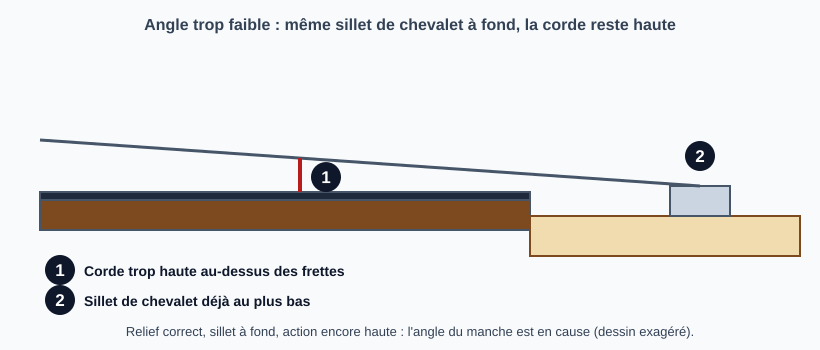
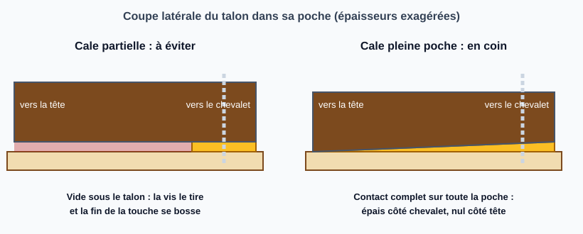
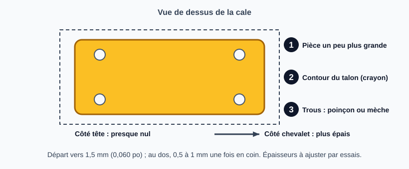

# Corriger l'angle d'un manche vissé avec une cale pleine poche

> Quand l'action reste trop haute alors que le sillet de chevalet est déjà au plus bas, on corrige l'angle d'un manche vissé en glissant une fine cale en coin dans toute la poche du talon.
> Suite de la fiche maîtresse [Refaire l'angle du manche (neck reset)](refaire-angle-du-manche.md), cas « manche vissé ».

## Risques et points de non-retour

- **Une cale mal faite abîme le manche.** Une cale courte, en papier, en plastique ou en bâtonnet laisse un vide sous le talon : la pression des vis tire le manche pour combler ce vide et la fin de la touche forme une bosse en « saut à ski ». Il faut alors poncer la touche pour enlever la bosse et refretter ; si la touche est trop mince, le manche est perdu (Premier Guitar).
- **Un angle réglé de travers peut gâcher un bon manche** (Premier Guitar) : procéder par petites épaisseurs et essayer à chaque fois.
- **Cette fiche ne couvre pas l'angle trop fort.** Si l'action est trop **basse** (frettes qui sonnent) alors que les sillets de chevalet sont à leur hauteur maximale, l'angle est trop fort : la cale décrite ici ne le corrige pas (Premier Guitar le distingue de l'angle trop faible).
- **Ce que la cale ne fait pas** : elle ne règle ni le relief ni les frettes, qu'il reste à contrôler ensuite.

## Outils et matériel

- Tournevis adapté aux vis du manche, clé de réglage du truss rod si besoin pour contrôler le relief ensuite
- Un morceau d'érable en placage ou en lamelle d'environ 1,5 mm (0,060 po) d'épaisseur, un peu plus large et un peu plus long que la poche (Premier Guitar) ; Haze Guitars parle plus généralement d'un feuillard de bois dur
- Crayon, scie à main fine ou scie à chantourner, papier de verre grain 80 collé sur un support plan ou ponceuse à bande, cyanoacrylate (colle instantanée) ; ruban double face pour maintenir la pièce
- Poinçon à cuir ou perceuse avec une mèche bien affûtée
- Pied à coulisse ou règle de précision, pour mesurer l'action avant et après
- Option : cale en coin du commerce de 0,25°, 0,5° ou 1° (StewMac, citée par Haze Guitars), moins fastidieuse à obtenir qu'une cale faite à la main

## Étapes

### 1. Confirmer que c'est bien l'angle

Le signe typique : la guitare est difficile à jouer, l'action reste haute alors que le sillet de chevalet est descendu aussi bas que possible, et la justesse peut en souffrir (Premier Guitar, Haze Guitars). Le relief doit déjà être correct, sinon le diagnostic est faux : voir [Mesurer le relief du manche](mesurer-relief-manche.md) et [Ajuster le truss rod](reglage-truss-rod.md). Il faut aussi avoir déjà essayé [Régler la hauteur des cordes au chevalet](regler-hauteur-chevalet.md).

Si l'action est bonne et que les sillets de chevalet ont de la marge, il n'y a rien à changer (Premier Guitar).

Les sources ne donnent aucune mesure de seuil pour cette étape (hauteur de corde en millimètres, par exemple) : se fier au constat « sillet à fond et action trop haute ».

### 2. Déposer le manche

Détendre les cordes, puis retirer les vis du manche (et la plaque, si elle existe). Cette étape de dépose n'est décrite dans les sources que de façon sommaire : c'est le geste habituel d'atelier.

Si la guitare a un système d'inclinaison réglable (micro-tilt de Fender, une vis qui pousse une plaque dans le talon), **Premier Guitar** recommande de retirer la vis de réglage et de visser le manche à plat, puis de poser une cale pleine poche si l'angle est trop faible : ce système peut tordre la fin de la touche. Haze Guitars le déconseille aussi.

### 3. Fabriquer la cale pleine poche

Le principe : une pièce en coin qui occupe **toute la poche**, épaisse du côté du chevalet et presque nulle du côté de la tête (Premier Guitar : « full-pocket » avec le bout un peu plus épais tourné vers le chevalet ; Haze Guitars : épaisseur voulue au fond de la poche, amincie jusqu'à presque rien à l'avant).

1. **Tracer le contour.** Poser le talon sur le morceau d'érable et suivre son contour au crayon. Couper un peu en dehors du trait, puis égaliser le bord au papier de verre grain 80 ou à la ponceuse à bande, en contrôlant la pièce dans la poche à chaque passe (Premier Guitar).
2. **Régler la longueur** avec le bord arrière de la poche comme règle, puis lisser la tranche (Premier Guitar).
3. **Donner la pente.** Colorer toute la face du dessous au crayon pour voir où l'on enlève de la matière, puis poncer à plat en appuyant davantage du côté qui doit rester mince (côté tête), et regarder l'ombre disparaître de façon régulière sur la largeur : on cherche un léger coin d'avant en arrière. Retirer peu à la fois (Premier Guitar). Haze Guitars conseille de coller la pièce au ruban double face sur un bloc plus grand pour la tenir, et de couper la forme avant d'amincir, car une cale très fine casse facilement.
4. **Percer les quatre trous.** Poser la cale dans la poche et visser un peu chaque vis pour qu'elle laisse une empreinte peu profonde ; déposer la cale, renforcer l'empreinte de quelques gouttes de cyanoacrylate, puis percer chaque trou au poinçon en le centrant sur l'empreinte (Premier Guitar). Haze Guitars perce avec une mèche légèrement plus grosse que la vis, doucement, ou au poinçon à cuir qu'on tourne dans les deux sens.

**Quelle épaisseur ?** Les sources ne donnent pas de conversion entre l'épaisseur et l'angle gagné. Haze Guitars indique une épaisseur au dos de seulement 0,5 mm à 1 mm, Premier Guitar part d'un placage d'environ 1,5 mm avant de poncer. Pour la cale du commerce, 0,5° suffit dans la plupart des cas, et 1° sert surtout à relever volontairement le chevalet d'une guitare décalée (Haze Guitars). À titre d'ordre de grandeur, un angle de 0,5° sur une poche d'environ 6 cm donne un peu moins de 0,6 mm de différence entre les deux bouts (calcul, la longueur de poche étant à vérifier sur la guitare).

### 4. Remonter, accorder, mesurer

Remettre la cale dans la **même orientation** (épais côté chevalet), visser le manche, tendre et accorder, puis **mesurer l'action et essayer la guitare** (Premier Guitar). La cale convient si les vis de sillet de chevalet permettent de régler l'action comme on le souhaite, avec assez de plage pour monter comme pour descendre.

Si l'action est encore trop haute, la cale est trop mince : en refaire une plus épaisse (déduction d'atelier). Si l'action est trop basse même avec les sillets de chevalet remontés, **retirer la cale et la poncer plus mince** ; cela peut demander plusieurs essais (Premier Guitar).

### 5. Contrôler le relief et les frettes

Mettre le manche droit au truss rod, vérifier le relief puis l'action, comme dans [Ajuster l'action](reglage-action.md). Après un changement d'angle, le travail de frettes est presque toujours nécessaire sur un neck reset de manche collé (Haze Guitars) ; pour une cale de manche vissé, les sources ne le disent pas : contrôler au moins les frettes proches du corps.

## Pièges et erreurs courantes

- **Cale courte** sous le talon (ou bâtonnet, plectre, carton, carte de visite) : vide d'air, tension des vis, bosse en fin de touche (Premier Guitar, Haze Guitars).
- **Matière molle ou compressible** (papier, plastique) : à éviter, Premier Guitar préfère un bois du même type que le manche.
- **Mauvais sens** : le coin épais doit être du côté du chevalet.
- **Poncer trop de matière d'un coup** : on ne peut pas remettre ce qu'on a enlevé.
- **Trop de cale** : l'action devient trop basse ; on la reprend en la ponçant.
- **Casser la cale en la perçant** : renforcer l'empreinte à la colle avant de percer, travailler doucement.
- **Confondre avec un problème de table ou de chevalet** : contrôler la table bombée ou le chevalet qui se décolle avant de conclure, comme dans la fiche maîtresse.

## Vérifications finales

- [ ] Action dans la cible avec une plage de réglage restante aux sillets de chevalet
- [ ] Le talon repose sur la cale sur toute la poche, sans vide visible ni jeu
- [ ] Les vis serrent sans forcer ; pas de bosse en fin de touche
- [ ] Relief correct, frettes sans bourdonnement
- [ ] Justesse contrôlée après l'accordage

## Sources et liens

- [Premier Guitar : Guitar Shop 101, How to Shim a Bolt-On Neck](https://www.premierguitar.com/gear/guitar-shop-101-how-to-shim-a-bolt-on-neck) : quand caler (sillet à fond, action haute), cale pleine poche en érable d'environ 1,5 mm, fabrication au crayon et au papier de verre, empreintes de vis, risque de bosse avec une cale partielle.
- [Haze Guitars : How to Shim a Bolt-On Neck](https://hazeguitars.com/how-to-shim-a-bolt-on-neck) : cale pleine poche, épaisseur au dos de 0,5 à 1 mm, double face et ponceuse, perçage, bosse en fin de touche et comment la reprendre.
- [Haze Guitars : Neck Shimming Made Easy](https://hazeguitars.com/blog/neck-shimming-made-easy) : cales du commerce de 0,25°, 0,5° et 1°, 0,5° suffisant dans la plupart des cas ; fabriquer la sienne est fastidieux ; cale partielle et système d'inclinaison déconseillés.

> Les sources ne donnent aucune valeur d'angle ou de seuil de diagnostic (hauteur de corde mesurée), ni de méthode de mesure de l'angle du manche, ni de conversion épaisseur-angle. La dépose du manche, le contrôle du relief et le ponçage de la poche ou du talon (autre façon de changer l'angle) sont des gestes d'atelier, non sourcés ici. Les schémas exagèrent les épaisseurs et les angles.

## Historique des révisions

| Date | Changement |
|------|------------|
| 2026-11-02 | Création du brouillon (3 schémas) ; sources : Premier Guitar et Haze Guitars |
