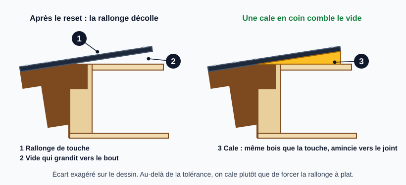
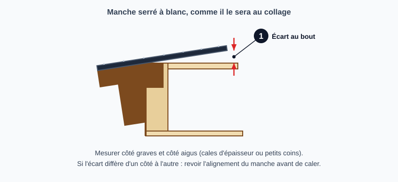
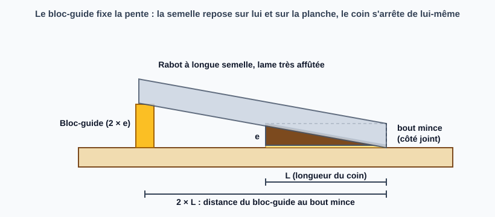
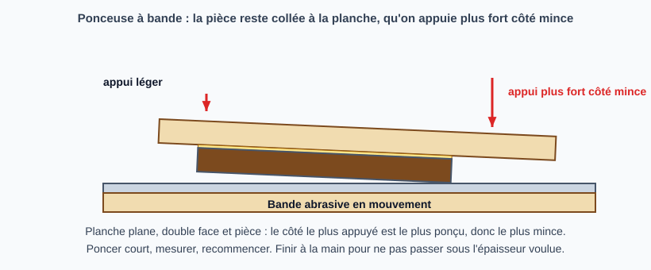
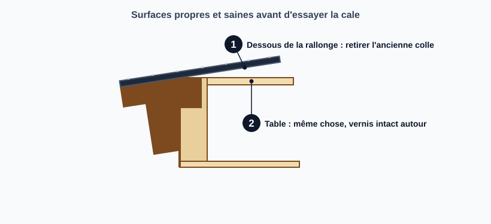
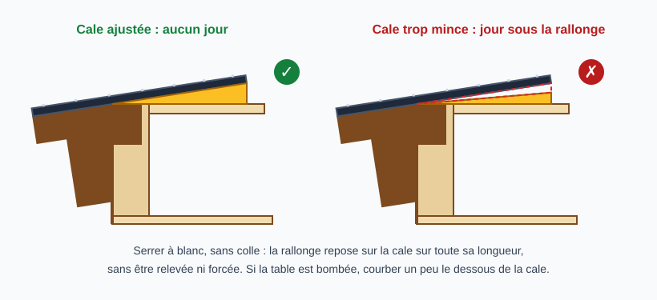
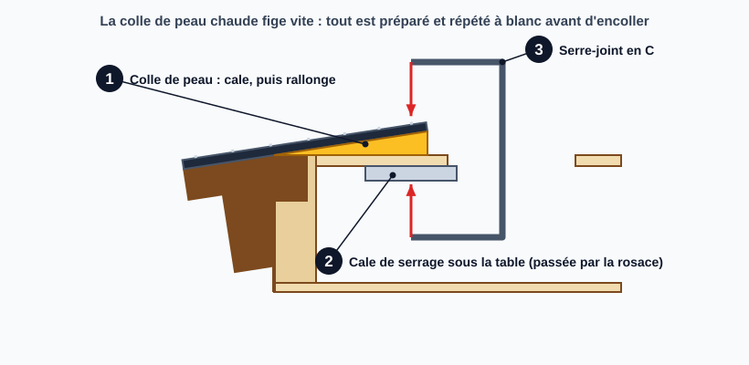
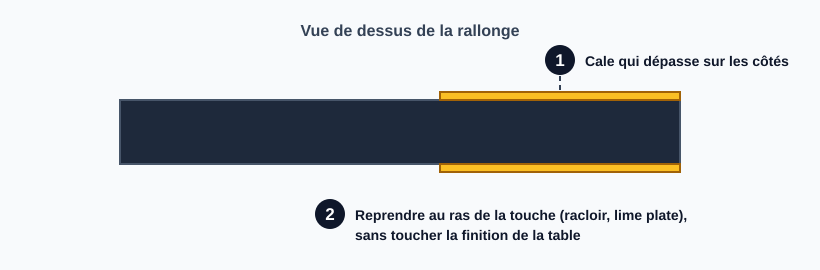
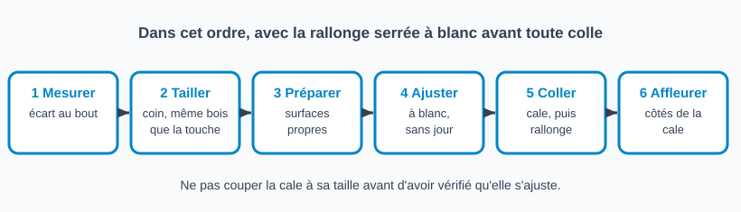

# Caler la rallonge de touche après un neck reset

> Après un neck reset, la rallonge de touche (la partie de la touche qui dépasse sur la table) peut se retrouver nettement au-dessus de la table.
> Si l'écart est faible, on la recolle à plat ; s'il est plus grand, on comble le vide avec une cale en coin taillée dans le bois de la touche, plutôt que de forcer la touche à plat.

## Risques et points de non-retour

- **Forcer à plat une rallonge trop haute** (au-delà de la tolérance) : la touche se tord à la sortie du manche, la déformation se voit et la contrainte reste dans le bois.
- **Cale mal ajustée** : un jour visible sur les côtés ou sous le bout, ou une cale trop épaisse qui relève la rallonge au lieu de la soutenir.
- **Coller avant d'avoir vérifié à blanc** : une cale collée de travers se retire difficilement sans abîmer la table ou la touche.
- **Colle qui déborde sur la finition** : protéger la table autour de la rallonge avant d'encoller.

## Quand caler ?

| Écart au bout de la rallonge (manche serré à blanc) | Décision |
|---|---|
| Faible (en dessous d'environ 2 mm) | Recoller à plat : le léger « kick-down » qui en résulte est acceptable |
| Supérieur | Poser une cale en coin |

> **Le seuil de 2 mm est une règle d'atelier, pas une valeur publiée.** Il varie avec la tolérance de chacun, la valeur de l'instrument et son aspect. Les sources donnent le principe (recoller à plat quand l'angle est faible, cale en coin quand il est plus grand) ; un seul fil chiffre, sur Luthiers Forum : une chute de la rallonge de 1/16 à 3/32 po (1,6 à 2,4 mm) est jugée acceptable par un intervenant, et une cale utile au-delà d'environ 1/20 po (1,3 mm) par un autre. Ce sont des avis individuels, pas une norme : le 1,3 mm est même plus bas que notre seuil de 2 mm, et la chute de 1,6 à 2,4 mm est mesurée depuis le joint une fois la touche collée, alors que l'écart de ce tableau se mesure à blanc sous le bout. Si la rallonge se plie visiblement, caler.

**Les avis divergent.** Haze Guitars juge la cale inutile dans la plupart des cas ; sur Luthiers Forum, un luthier cale la majorité des touches après un reset, un autre presque jamais, et certains participants jugent même souhaitable un peu de chute de la rallonge.

## Outils et matériel

- Chute du même bois que la touche (palissandre, ébène, érable selon la touche)
- Cales d'épaisseur ou petits coins pour mesurer l'écart
- Pour fabriquer la cale : rabot à longue semelle et bloc-guide (méthode manuelle), ou ponceuse à bande ou à épaisseur avec une planche support ; ruban double face ; scie à ruban ou scie sur table avec un traîneau ; ciseau à bois, cale de ponçage, papier de verre et racloir pour finir ; masque contre les poussières
- Racloir ou lame pour retirer l'ancienne colle
- Colle de peau (chaude, ou liquide si elle est fraîche)
- Serre-joint en C et cale de serrage qui passe par la rosace et épouse la barre transversale sous la table
- Ruban de protection, chiffon humide

## Étapes

### 1. Mesurer l'écart

Manche en place et serré à blanc, comme il le sera au collage (l'essai à blanc du manche précède son collage), mesurer l'écart sous le bout de la rallonge avec des cales d'épaisseur ou de petits coins, côté graves et côté aigus.

Si l'écart diffère d'un côté à l'autre, ne pas tailler une cale en biais : c'est le signe d'un manche mal aligné ou vrillé, à revoir avant de caler.

### 2. Tailler le coin

Dans le bois de la touche, tailler une cale en coin dont l'épaisseur au gros bout égale l'écart mesuré, amincie jusqu'à presque rien juste avant le joint avec le manche. Un coin du même bois que la touche passe inaperçu sur la tranche visible.

#### Fabriquer la cale en coin

Les sources lues décrivent plusieurs façons de faire. Aucune ne donne de fiche complète : ce sont des messages de forum, qui se recoupent.

**Point de départ commun.** Prendre une pièce de bois de touche plus longue que la cale, mise à l'épaisseur de l'écart mesuré, ou un peu moins pour garder une légère chute au bout (de l'ordre de 0,4 mm, soit environ 15 millièmes de pouce, selon Colin North sur Luthiers Forum). La tailler un peu plus grande que la rallonge : on la coupe à sa taille seulement une fois ajustée, et on la laisse un peu longue pour le serrage (Terry Stowell). Fil dans la longueur, comme la touche, et rabotage dans le sens du fil : pratique d'atelier, aucune des sources lues ne traite du sens du fil. Sur de l'ébène ou du palissandre à contre-fil, une lame très fine ou un racloir évite les arrachements (même statut).

**Au rabot** (outil manuel). Fixer la pièce au ruban double face sur une planche plane, puis soutenir l'arrière du rabot par un bloc-guide d'épaisseur connue : la semelle repose sur le bloc et sur la planche, sa pente ne bouge pas pendant la course, et on arrête quand le rabot ne coupe plus. Règle donnée par John Parchem sur Luthiers Forum, d'après un tutoriel de Todd Stock qui n'est plus en ligne, avec un montage décrit par Colin North (qui n'était pas sûr de tous les détails) :
- Pour une cale qui s'annule à zéro, le bloc-guide fait **deux fois l'épaisseur voulue au gros bout**, et se place **à deux fois la longueur de la cale**, mesurée depuis le bout mince.
- Si le bout mince n'est pas nul, le bloc fait deux fois la **différence** entre le gros bout et le bout mince ; on arrête quand le bout mince atteint sa cote.
- La semelle doit être nettement plus longue que 2 × la longueur de la cale : au-delà d'un coin de la moitié de la semelle, la règle ne tient plus (Tony Karol, qui a fini au rabot de 14 po). Il faut donc un rabot à **longue semelle** ; un rabot de coupe (block plane) rend la tâche difficile.
- Lame très affûtée et réglée fin (Colin North).

**À la ponceuse à bande ou à épaisseur** (outil électrique). Fixer la pièce au ruban double face sur une planche plane (Todd Mylet, Richard Loren) ; avec une ponceuse à épaisseur, Barry Daniels utilise une planche support, des cales de chute et du double face. Pour former le coin à la bande, appuyer plus fort du côté qui doit être mince, poncer court et mesurer souvent (mécanisme logique, pratique d'atelier non sourcée). Un intervenant juge la ponceuse à bande l'option qui semble la plus sûre.

**À la scie.** Mike_P recommande la scie circulaire sur table ou la scie à ruban avec un gabarit (un traîneau avec serre-joints) pour couper le coin, et juge la scie à onglet dangereuse pour ce genre de travail.

**Finir à la main.** Ciseau à bois, cale de ponçage et papier de verre servent aux retouches (David Collins). On contrôle la cale aux cales d'épaisseur et en serrant à blanc, à plusieurs reprises (voir étape 4). Elle peut être courbée sur sa face du dessous pour suivre une bosse de la table (David Collins).

> **Sécurité** (principes d'atelier, non sourcés ici) : une pièce fine tenue à la main se fait happer ou éjecter par la bande ou la lame, donc la fixer sur un support, garder les doigts hors de la trajectoire et partir d'une pièce longue. Le double face peut lâcher sous la chaleur de la bande ou l'effort : l'essayer sur une chute. Ne pas viser zéro au bout mince aux machines (un bord trop fin éclate ou se fait happer ; par exemple 0,3 à 0,5 mm), puis finir à la main. La poussière de palissandre ou d'ébène irrite et sensibilise : masque et aspiration.

### 3. Préparer les surfaces

Retirer l'ancienne colle sous la rallonge et sur la table, sans toucher à la finition autour (voir [Nettoyer et dégraisser une fissure avant collage](nettoyer-avant-collage.md) pour le dégraissage). Protéger la table au ruban.

### 4. Ajuster à blanc

Serrer à blanc, sans colle : la rallonge doit reposer sur la cale sur toute sa longueur, sans être relevée ni forcée, et sans jour sur les côtés. Si la table est légèrement bombée, courber un peu le dessous de la cale pour l'épouser (David Collins, Luthiers Forum). Répéter le serrage à blanc jusqu'à ce que le geste soit sûr : la colle de peau chaude fige vite.

### 5. Coller et serrer

Les sources ne précisent pas l'ordre des collages. Pratique courante : coller la cale sous la rallonge, puis l'ensemble sur la table à la colle de peau, serrer avec la cale de serrage passée par la rosace, essuyer l'excédent à l'humide. Laisser sécher au moins une nuit (délai d'atelier, à confirmer).

### 6. Affleurer

Reprendre les côtés de la cale au ras de la touche (racloir ou lime plate), sans toucher à la finition de la table. Vérifier qu'aucun jour ne subsiste.

## Pièges et erreurs courantes

- Couper la cale à sa taille avant de l'avoir essayée en place.
- Mesurer l'écart manche non serré : l'écart réel au collage est différent.
- Une cale d'une autre essence, visible sur la tranche de la touche.
- Une cale épaisse jusqu'au joint : elle relève la rallonge au lieu de la soutenir.
- Serrer fort pour rattraper un mauvais ajustement : la touche reste en contrainte.
- Un écart inégal entre graves et aigus compensé par une cale en biais au lieu de corriger le manche.

## Vérifications finales

- [ ] La rallonge repose sur la cale sur toute sa longueur, sans jour
- [ ] Cale de même épaisseur des deux côtés, aucun jour visible
- [ ] La touche n'est pas tordue à la sortie du manche
- [ ] Colle essuyée, finition de la table intacte
- [ ] Cale du même bois que la touche, discrète sur la tranche

## Sources et liens

- [Haze Guitars : Neck Resets 9, Finishing up](https://hazeguitars.com/blog/neck-resets-finishing-up) : si l'angle du reset n'est pas trop sévère, on peut serrer la touche contre la table (léger « kick-down ») ; pour un angle plus grand, une cale en coin sous la rallonge devient nécessaire ; la cale n'est pas utile dans la plupart des cas.
- [Haze Guitars : Neck Reset 8, Putting it all back together](https://hazeguitars.com/blog/neck-reset-putting-it-back-together) : colle de peau chaude recommandée pour le remontage (liquide acceptable si fraîche) ; la rallonge est collée à la table, serrage par la rosace avec une cale épousant la barre.
- [Luthiers Forum : Neck-set, Shimming the Fretboard?](https://www.luthiersforum.com/forum/viewtopic.php?p=234000) : cale du même matériau que la touche, amincie presque à rien avant le joint ; ajustement à blanc ; ne pas couper à la taille avant ajustement ; fabrication à la ponceuse sur planche support au double face, ou à la scie avec gabarit ; cale courbée dessous pour suivre une bosse de la table.
- [Luthiers Forum : Oops. What do you suggest?](https://www.luthiersforum.com/forum/viewtopic.php?p=619476) : cale de rallonge taillée au rabot dans du bois de touche mis à l'épaisseur de l'écart (un peu moins, pour garder une légère chute) ; chute de la rallonge de 1/16 à 3/32 po (1,6 à 2,4 mm) citée par un intervenant ; cale jugée utile au-delà d'environ 1/20 po (1,3 mm) selon un autre.
- [Luthiers Forum : Making precise thin wedges](https://www.luthiersforum.com/forum/viewtopic.php?p=567697) : coin taillé au rabot, pièce fixée au double face, bloc-guide sous l'arrière du rabot (2 × l'épaisseur, à 2 × la longueur) ; règle valable tant que le coin ne dépasse pas la moitié de la semelle (rabot de 14 po).

> Le seuil d'environ 2 mm vient de la pratique de l'atelier ; les seules valeurs chiffrées lues sont deux avis du fil Luthiers Forum « Oops. What do you suggest? » (chute de 1,6 à 2,4 mm, cale utile au-delà de 1,3 mm environ), cités plus haut. Le bois identique à la touche est confirmé par Luthiers Forum. L'ordre des collages et le délai de séchage viennent de l'atelier. La Titebond n'est pas retenue : aucune source lue ne la mentionne pour cette opération.

## Historique des révisions

| Date | Changement |
|------|------------|
| 2026-10-30 | Création du brouillon, seuil et matériau d'après la pratique d'atelier, méthode d'après Haze Guitars et Luthiers Forum |
| 2026-10-30 | Relecture : contradiction « plier » corrigée, étape de préparation des surfaces, un schéma par étape, divergences des sources signalées |
| 2026-11-01 | Sous-section « Fabriquer la cale en coin » (rabot, ponceuse, scie, finition) avec 2 schémas ; deux sources Luthiers Forum ajoutées, dont les seules valeurs chiffrées lues |
| 2026-11-01 | Relecture Opus : règle du bloc-guide complétée (bout non nul, longueur de semelle), « rabot à longue semelle », schémas 09 et 10 redessinés, sécurité et sens du fil ajoutés, attributions précisées, outils et seuils harmonisés |
| 2026-11-05 | Schémas 01, 03, 05, 06 et 07 redessinés sur la coupe commune (`_banque/coupe.py`) : même manche, même table, même rosace que le reste de la série |
