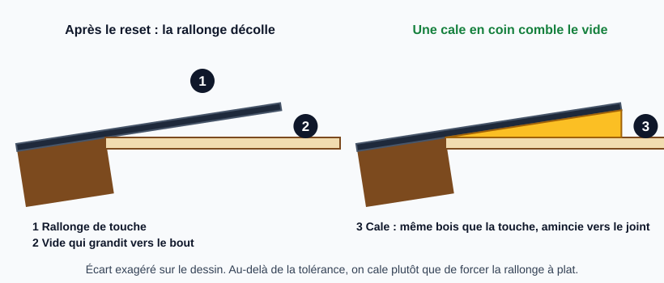
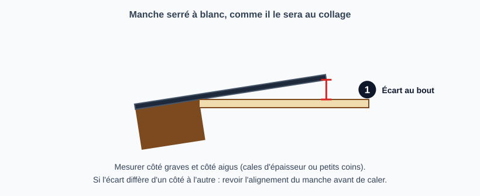
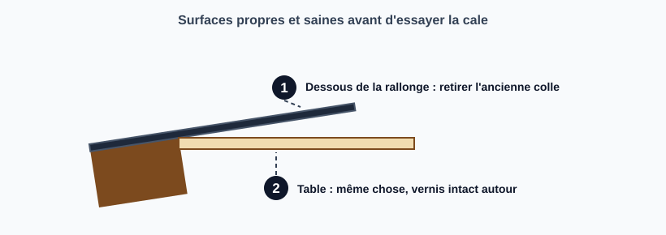
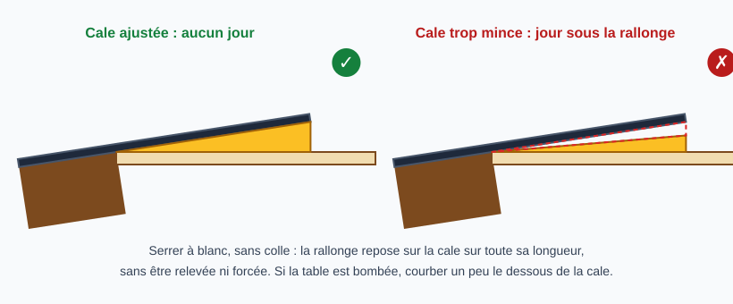
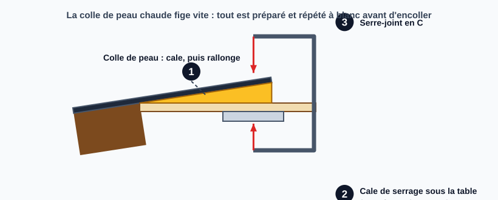
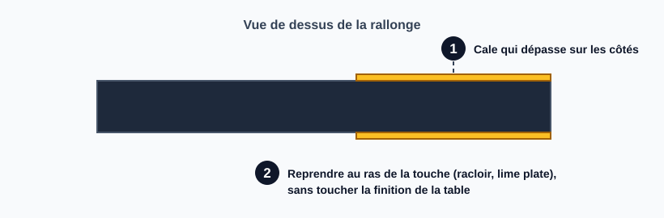
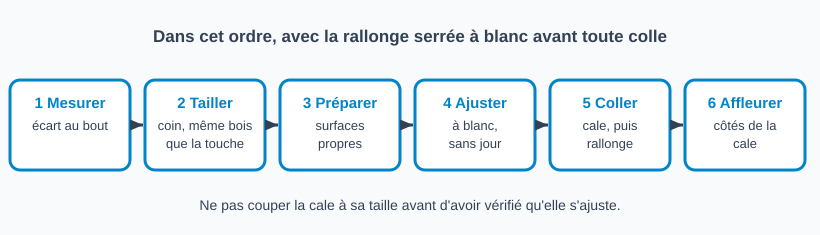

# Caler la rallonge de touche après un neck reset

> Après un neck reset, la rallonge de touche (la partie de la touche qui dépasse sur la table) peut se retrouver nettement au-dessus de la table.
> Si l'écart est faible, on la recolle à plat ; s'il est plus grand, on comble le vide avec une cale en coin taillée dans le bois de la touche, plutôt que de forcer la touche à plat.

## Risques et points de non-retour

- **Forcer à plat une rallonge trop haute** (au-delà de la tolérance) : la touche se tord à la sortie du manche, la déformation se voit et la contrainte reste dans le bois.
- **Cale mal ajustée** : un jour visible sur les côtés ou sous le bout, ou une cale trop épaisse qui relève la rallonge au lieu de la soutenir.
- **Coller avant d'avoir vérifié à blanc** : une cale collée de travers se retire difficilement sans abîmer la table ou la touche.
- **Colle qui déborde sur la finition** : protéger la table autour de la rallonge avant d'encoller.

## Quand caler ?

| Écart au bout de la rallonge (manche serré à blanc) | Décision |
|---|---|
| Faible (en dessous d'environ 2 mm) | Recoller à plat : le léger « kick-down » qui en résulte est acceptable |
| Supérieur | Poser une cale en coin |

> **Le seuil de 2 mm est une règle d'atelier, pas une valeur publiée.** Il varie avec la tolérance de chacun, la valeur de l'instrument et son aspect. Les sources lues donnent le principe (recoller à plat quand l'angle est faible, cale en coin quand il est plus grand) sans chiffre. Si la rallonge se plie visiblement, caler.

**Les avis divergent.** Haze Guitars juge la cale inutile dans la plupart des cas ; sur Luthiers Forum, un luthier cale la majorité des touches après un reset, un autre presque jamais, et certains participants jugent même souhaitable un peu de chute de la rallonge.

## Outils et matériel

- Chute du même bois que la touche (palissandre, ébène, érable selon la touche)
- Cales d'épaisseur ou petits coins pour mesurer l'écart
- Papier de verre collé sur un support plan, ou ponceuse à bande avec un support pour tenir la petite pièce
- Racloir ou lame pour retirer l'ancienne colle
- Colle de peau (chaude, ou liquide si elle est fraîche)
- Serre-joint en C et cale de serrage qui passe par la rosace et épouse la barre transversale sous la table
- Ruban de protection, chiffon humide

## Étapes

### 1. Mesurer l'écart

Manche en place et serré à blanc, comme il le sera au collage (l'essai à blanc du manche précède son collage), mesurer l'écart sous le bout de la rallonge avec des cales d'épaisseur ou de petits coins, côté graves et côté aigus.

Si l'écart diffère d'un côté à l'autre, ne pas tailler une cale en biais : c'est le signe d'un manche mal aligné ou vrillé, à revoir avant de caler.

### 2. Tailler le coin

Dans le bois de la touche, tailler un coin dont l'épaisseur au gros bout égale l'écart mesuré, aminci jusqu'à presque rien juste avant le joint avec le manche. Un coin du même bois que la touche passe inaperçu sur la tranche visible. Le tailler un peu plus grand que la rallonge : on le coupe à sa taille seulement une fois ajusté.

### 3. Préparer les surfaces

Retirer l'ancienne colle sous la rallonge et sur la table, sans toucher à la finition autour (voir [Nettoyer et dégraisser une fissure avant collage](nettoyer-avant-collage.md) pour le dégraissage). Protéger la table au ruban.

### 4. Ajuster à blanc

Serrer à blanc, sans colle : la rallonge doit reposer sur la cale sur toute sa longueur, sans être relevée ni forcée, et sans jour sur les côtés. Si la table est légèrement bombée, courber un peu le dessous de la cale pour l'épouser (pratique d'atelier, non sourcée). Répéter le serrage à blanc jusqu'à ce que le geste soit sûr : la colle de peau chaude fige vite.

### 5. Coller et serrer

Les sources ne précisent pas l'ordre des collages. Pratique courante : coller la cale sous la rallonge, puis l'ensemble sur la table à la colle de peau, serrer avec la cale de serrage passée par la rosace, essuyer l'excédent à l'humide. Laisser sécher au moins une nuit (délai d'atelier, à confirmer).

### 6. Affleurer

Reprendre les côtés de la cale au ras de la touche (racloir ou lime plate), sans toucher à la finition de la table. Vérifier qu'aucun jour ne subsiste.

## Pièges et erreurs courantes

- Couper la cale à sa taille avant de l'avoir essayée en place.
- Mesurer l'écart manche non serré : l'écart réel au collage est différent.
- Une cale d'une autre essence, visible sur la tranche de la touche.
- Une cale épaisse jusqu'au joint : elle relève la rallonge au lieu de la soutenir.
- Serrer fort pour rattraper un mauvais ajustement : la touche reste en contrainte.
- Un écart inégal entre graves et aigus compensé par une cale en biais au lieu de corriger le manche.

## Vérifications finales

- [ ] La rallonge repose sur la cale sur toute sa longueur, sans jour
- [ ] Cale de même épaisseur des deux côtés, aucun jour visible
- [ ] La touche n'est pas tordue à la sortie du manche
- [ ] Colle essuyée, finition de la table intacte
- [ ] Cale du même bois que la touche, discrète sur la tranche

## Sources et liens

- [Haze Guitars : Neck Resets 9, Finishing up](https://hazeguitars.com/blog/neck-resets-finishing-up) : si l'angle du reset n'est pas trop sévère, on peut serrer la touche contre la table (léger « kick-down ») ; pour un angle plus grand, une cale en coin sous la rallonge devient nécessaire ; la cale n'est pas utile dans la plupart des cas.
- [Haze Guitars : Neck Reset 8, Putting it all back together](https://hazeguitars.com/blog/neck-reset-putting-it-back-together) : colle de peau chaude recommandée pour le remontage (liquide acceptable si fraîche) ; la rallonge est collée à la table, serrage par la rosace avec une cale épousant la barre.
- [Luthiers Forum : Neck-set, Shimming the Fretboard?](https://www.luthiersforum.com/forum/viewtopic.php?p=234000) : cale taillée dans le même matériau que la touche, amincie presque à rien avant le joint ; ajustement à blanc au calibre d'épaisseur ; ne pas couper à la taille avant ajustement ; avis partagés sur la nécessité de caler.

> Le seuil d'environ 2 mm vient de la pratique de l'atelier ; aucune des sources lues ne publie de valeur chiffrée pour l'écart. Le bois identique à la touche est confirmé par Luthiers Forum. L'ordre des collages, le délai de séchage et la cale courbée sur une table bombée viennent de l'atelier. La Titebond n'est pas retenue : aucune source lue ne la mentionne pour cette opération.

## Historique des révisions

| Date | Changement |
|------|------------|
| 2026-10-30 | Création du brouillon, seuil et matériau d'après la pratique d'atelier, méthode d'après Haze Guitars et Luthiers Forum |
| 2026-10-30 | Relecture : contradiction « plier » corrigée, étape de préparation des surfaces, un schéma par étape, divergences des sources signalées |
