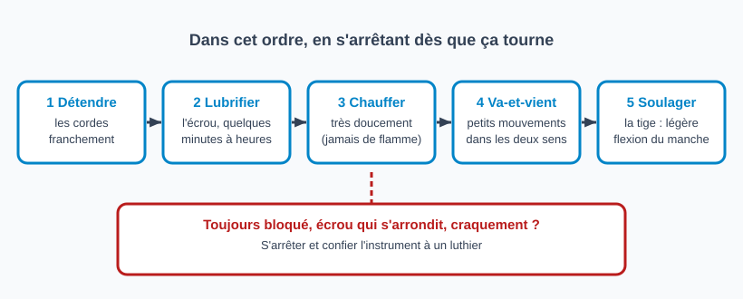

# Débloquer un truss rod coincé

> Un truss rod « coincé » est un écrou qui ne tourne pas, ou une tige qui résiste fortement. On essaie
> des moyens doux, dans un ordre précis, et on s'arrête dès que ça tourne : insister risque de casser
> la tige ou de fendre le manche.

## Risques et points de non-retour

- **Forcer** : filetage arraché, tige cassée, manche fendu. Irréparable ou coûteux.
- **Écrou qui s'arrondit** : la clé glisse ; arrêter.
- **Chaleur** : jamais de flamme ; ne pas surchauffer le vernis ni le bois.
- **Lubrifiant** : le garder sur le filetage, pas dans le bois ni sur la touche.
- **Blocage qui revient** : une fois libéré, le truss rod doit être nettoyé et regraissé (voir *Après le déblocage*).

## Avant de conclure à un blocage

Vérifier que la clé est exacte et bien enfoncée, que le sens de rotation tenté est le bon, et que les cordes sont accordées ou légèrement détendues (voir la fiche [Ajuster le truss rod](reglage-truss-rod.md)).

## Outils et matériel

- Clé du bon format
- Lubrifiant adapté (huile fine)
- Sèche-cheveux (jamais de flamme)
- Vaseline ou graisse fine pour le remontage

## Étapes

À essayer **dans cet ordre**, en s'arrêtant dès que ça tourne :

1. **Détendre franchement les cordes** : la tige ne lutte plus contre la tension.
2. **Nettoyer et lubrifier l'écrou** : un peu d'huile fine sur le filetage, sans en mettre dans le bois ni sur la touche. Laisser agir quelques minutes à quelques heures.
3. **Chauffer très doucement** : jamais de flamme. Des luthiers chauffent l'écrou avec un **fer à souder propre**, vernis voisin protégé, en évitant de se brûler et sans casser la tige (Luthiers Forum) ; un sèche-cheveux est une alternative plus douce mais **non sourcée**.
4. **Tourner en va-et-vient** : de minuscules mouvements dans les deux sens (une fraction de quart de tour), en gagnant un peu à chaque passage, plutôt qu'un effort continu dans un seul sens.
5. **Soulager la tige** : en soutenant le manche, exercer une légère flexion à la main dans le sens qui diminue l'effort sur la tige pendant qu'on tourne, avec précaution.

## Après le déblocage

Ne pas laisser tel quel : le blocage reviendra.

1. Mesurer le relief sous tension, puis cordes détendues, et noter les deux valeurs (voir [Mesurer le relief du manche](mesurer-relief-manche.md)).
2. Dévisser complètement l'écrou, sans forcer, et le retirer de la tige.
3. Essuyer le filetage (tige et écrou) et déposer une très petite quantité de graisse (par exemple de la vaseline) sur la tige.
4. Remettre l'écrou et le serrer jusqu'à retrouver le relief noté, par quarts de tour, en remesurant.

Sur certains modèles, l'écrou n'est pas démontable sans retirer d'autres pièces (cache, rosace, pickguard) : ne démonter que si on sait comment l'instrument se remonte.

## Quand s'arrêter

Confier l'instrument à un luthier si la tige reste bloquée après ces essais, si l'écrou commence à s'arrondir, si on entend ou sent un craquement, ou si le manche semble sous contrainte.

## Pièges et erreurs courantes

- Passer directement à la force ou à un outil de fortune.
- Utiliser une flamme ou surchauffer.
- Verser du lubrifiant en excès dans le bois de la touche.
- Remonter l'écrou sans regraisser le filetage.

## Vérifications finales

- [ ] L'écrou tourne sans résistance anormale
- [ ] Filetage nettoyé et très légèrement graissé
- [ ] Relief retrouvé et vérifié après réaccordage
- [ ] Aucune trace de lubrifiant sur le bois ou la touche

## Sources et liens

- [Premier Guitar : Emergency truss rod tweaks](https://www.premierguitar.com/articles/Emergency_Truss_Rod_Tweaks) : cas difficiles, dont les truss rods récalcitrants.
- [Luthiers Forum : fret levelling with relief](https://www.luthiersforum.com/forum/viewtopic.php?p=688239) : fil de luthiers sur une tige « bloquée » : huile pénétrante sur l'écrou, chaleur au fer à souder, petits mouvements dans les deux sens, graissage préventif du filetage, tige à réparer avant un refret.

> Le déblocage s'appuie surtout sur des échanges de forums de luthiers : seul le fil du Luthiers Forum a été relu (huile pénétrante, chaleur au fer à souder, va-et-vient, graisse anti-grippage en prévention, quand renoncer). Détendre les cordes, soulager la tige par une légère flexion du manche et démonter l'écrou pour le regraisser viennent de la fiche d'origine et d'avis non relus : à confirmer avec la pratique de l'atelier. Aucune vidéo n'est encore référencée. Trois autres fils de forum (TalkBass, Gibson, MIMF) étaient inaccessibles.

## Historique des révisions

| Date | Changement |
|------|------------|
| 2026-10-30 | Création du brouillon, extraite de la section « Débloquer un truss rod coincé » de la fiche « Ajuster le truss rod » ; schéma de l'ordre des essais |
