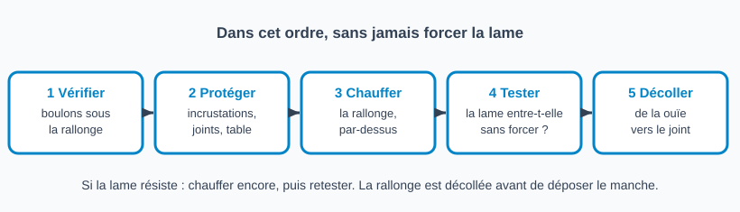
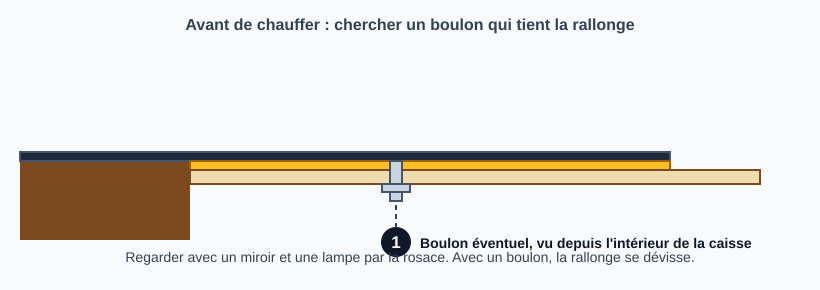
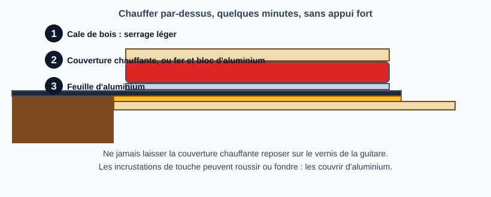
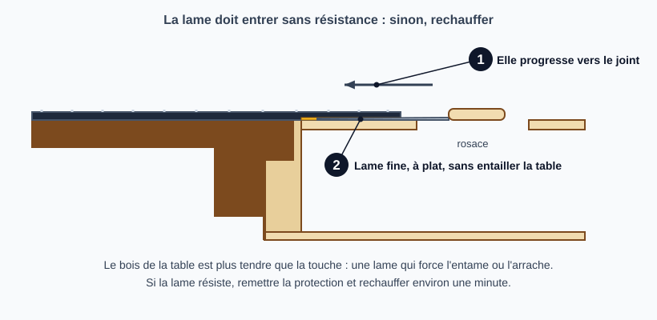
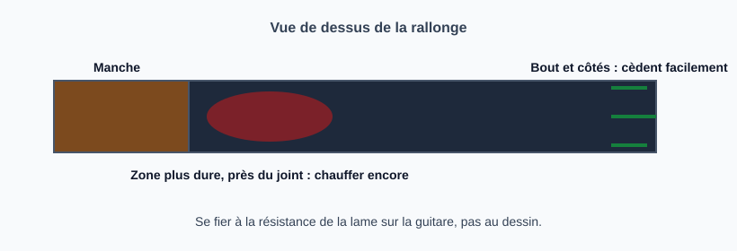

# Décoller la rallonge de touche de la table

> Avant de déposer un manche collé, on libère d'abord la rallonge de touche, la partie de la touche qui repose sur la table : on la chauffe pour ramollir la colle, puis on glisse une lame fine entre la touche et la table.
> C'est la première étape d'un neck reset sur un manche collé (voir [Refaire l'angle du manche](refaire-angle-du-manche.md)).

## Risques et points de non-retour

- **Entamer ou arracher la table** : le bois de la table (épicéa, cèdre) est plus tendre que la touche. Une lame qui force l'entame ou arrache des fibres (Crawls Backward, Forsyth).
- **Brûler le vernis ou les incrustations** : une couverture chauffante qui repose sur le vernis le brûle, et les incrustations de touche peuvent roussir ou fondre (Haze Guitars).
- **Forcer** : si la lame résiste, la bonne réponse est de chauffer davantage, jamais de pousser (Haze Guitars, Forsyth).
- **Instrument de valeur** : à ne pas tenter sans avoir déjà vu faire l'opération.

## Outils et matériel

- Source de chaleur : couverture chauffante électrique (méthode préférée par Haze Guitars), ou fer à repasser avec un bloc d'aluminium pour répartir la chaleur (Forsyth), ou bloc de métal chauffé sur une plaque
- Cale de bois pour presser légèrement la source de chaleur sur la rallonge
- Feuille d'aluminium (éventuellement collée sur un carton) pour protéger la table et les incrustations
- Spatule ou couteau à palette fin, éventuellement chauffé lui aussi
- Cutter très affûté pour tracer les joints
- Miroir et lampe pour regarder sous la rallonge

## Étapes

### 1. Chercher un boulon

Avant de chauffer, regarder par la rosace avec un miroir et une lampe : certaines guitares ont un ou deux boulons qui tiennent la rallonge à la table (Haze Guitars). Si c'est le cas, la rallonge se dévisse et on évite une grande partie du chauffage.

### 2. Protéger

- Tracer les joints de la touche avec un cutter très affûté avant de chauffer, pour limiter les éclats de vernis (Haze Guitars).
- Couvrir les incrustations de touche d'une ou deux couches d'aluminium (Haze Guitars).
- Poser une protection en aluminium entre la source de chaleur et le vernis de la table ; Crawls Backward utilise une feuille collée sur un carton, avec un morceau de feuille dans l'interstice à côté de la touche.

### 3. Chauffer

Poser la source de chaleur sur la rallonge, par-dessus l'aluminium, et la tenir avec la cale de bois, sans appui fort (Haze Guitars). Le premier chauffage peut prendre quelques minutes (Haze Guitars). Aucune des sources lues ne donne de température chiffrée.

Crawls Backward chauffe par passages d'environ une minute avec un fer réglé presque au plus chaud, et chauffe aussi la spatule sous le fer.

### 4. Tester

Retirer la protection et essayer de glisser la spatule entre la touche et la table, en commençant du côté de la ouïe (Haze Guitars). Si la lame entre sans résistance, la colle a lâché ; sinon, remettre la protection, chauffer environ une minute de plus et retester (Haze Guitars, Crawls Backward).

### 5. Décoller

Faire avancer la lame de la ouïe vers le joint avec le manche. Le bout et les côtés cèdent facilement, une zone plus dure se trouve vers le centre (Crawls Backward) : chauffer de nouveau avant d'insister. Crawls Backward a eu besoin d'environ quatre passages chaleur-spatule pour atteindre le joint.

### 6. Suite

Une fois la rallonge libre, l'accès à la queue d'aronde se fait en retirant une frette au-dessus du joint (la 15e sur une guitare courante, la 13e sur un petit instrument comme un tenor) et en perçant la fente pour y glisser la vapeur : voir la fiche de dépose du manche (fiche à venir). Les frettes de vieux instruments plient facilement : les mettre de côté (Crawls Backward).

## Pièges et erreurs courantes

- Chauffer sans avoir cherché de boulon sous la rallonge.
- Laisser la couverture chauffante reposer sur le vernis.
- Forcer la lame au lieu de rechauffer.
- Insister vers le centre sans rechauffer : c'est la zone qui résiste le plus.
- Oublier de protéger les incrustations de touche.

## Vérifications finales

- [ ] La rallonge est entièrement libre, sans accroc au bout ni sur les côtés
- [ ] Le vernis de la table est intact autour de la touche
- [ ] Les incrustations de touche n'ont pas chauffé
- [ ] Aucune entaille ni fibre arrachée sur la table
- [ ] Les frettes retirées, s'il y en a, sont rangées dans l'ordre

## Sources et liens

- [Haze Guitars : Neck Resets 2, Beginning to remove the neck](https://hazeguitars.com/blog/neck-resets-starting-to-remove-the-neck) : couverture chauffante ou bloc de métal, cale de bois, protection des incrustations à l'aluminium, joints tracés au cutter, boulons éventuels, test à la spatule, ne pas forcer.
- [Crawls Backward : Loosening Fingerboard Extension on 1930s Regal Tenor Guitar](https://crawlsbackward.blogspot.com/2015/09/loosening-fingerboard-extension-on.html) : fer chauffant par passages d'environ une minute à travers une protection d'aluminium, zone plus dure près du joint, risque d'arracher la table, frette retirée pour l'accès vapeur.
- [Forsyth Music Shop : Workshop Diary, Resetting The Neck On A Fylde Guitar](https://www.forsyths.co.uk/blog/814-workshop-diary-resetting-the-neck-on-a-fylde-guitar) : fer et bloc d'aluminium pour répartir la chaleur, lames à palette glissées sous la touche, plus de chaleur plutôt que d'entamer la table en cèdre.

> Aucune des trois sources ne donne de température ni d'épaisseur de lame. Les durées d'une minute par passage viennent d'un seul atelier (Crawls Backward) et sont à confirmer par la pratique.

## Historique des révisions

| Date | Changement |
|------|------------|
| 2026-10-31 | Création du brouillon, d'après Haze Guitars, Crawls Backward et Forsyth Music Shop |
