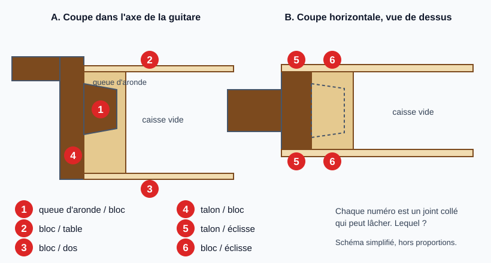
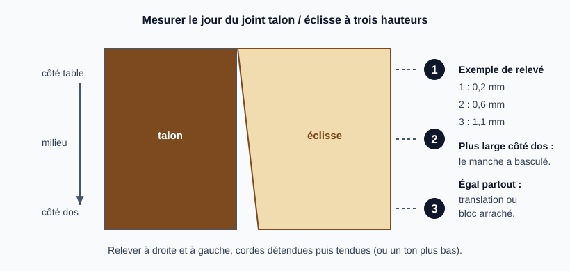
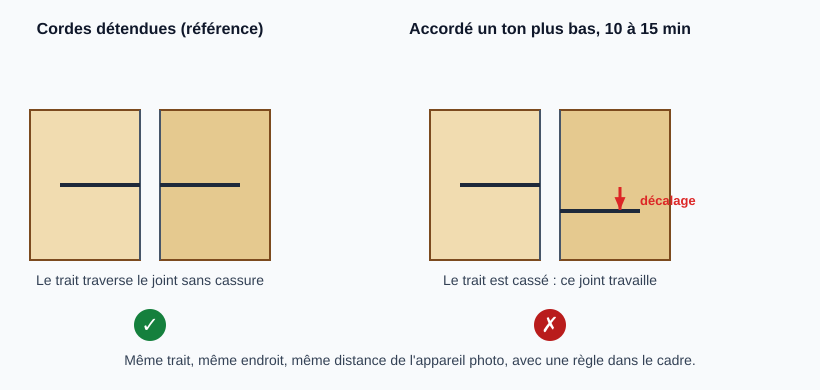
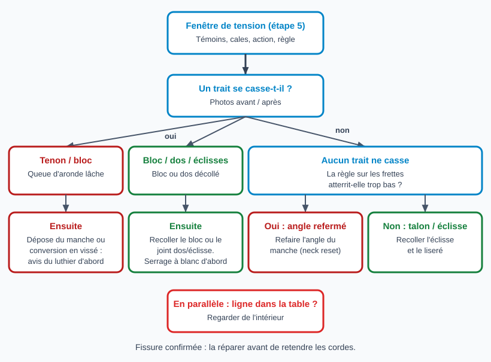

# Diagnostiquer un talon ou une éclisse qui se décolle à la jonction du manche

> Quand le talon s'ouvre contre une éclisse ou que le manche ne reprend plus sa place, il faut savoir **quel joint
> collé a lâché** avant de coller quoi que ce soit : la réparation n'est pas la même si c'est la queue d'aronde, le
> bloc de manche ou l'angle du manche. Cette fiche sert à trancher, sans rien démonter. Elle décrit une guitare
> **acoustique à table plate** à manche collé en queue d'aronde. Les tests viennent d'un avis d'IA et de la pratique
> d'atelier, **pas encore confirmés par un luthier** : voir la note en fin de fiche.

## Risques et points de non-retour

- **Retendre les cordes** avec un joint qui travaille peut aggraver l'ouverture (déchirure du contreplaqué ou du bois massif, bloc arraché, fissure de la table). Garder les cordes détendues, sauf pendant la **fenêtre de tension unique** de l'étape 5.
- **Pas de test sous tension** si une fissure de table est confirmée à l'étape 3, ou si le chevalet se soulève.
- **Coller avant de savoir** quel joint bouge : de la colle injectée dans une queue d'aronde lâche fige le manche dans une mauvaise position et rend la dépose ultérieure beaucoup plus dure. **Aucune colle dans cette fiche.**
- **Forcer** l'éclisse ou le talon à la main ou au serre-joint sans colle ne réaligne rien et peut délaminer un contreplaqué, fendre le bois massif ou fissurer le fini.
- **Aucun solvant ni chaleur sur le fini** pendant le diagnostic.

## Outils et matériel

- Hygromètre (voir [Laisser une guitare retrouver une humidité normale](retrouver-humidite-normale.md))
- Lampe LED froide puissante ou lampe frontale (une ampoule à incandescence chauffe le bois et le fini) ; miroir d'inspection (ou miroir de dentiste) ; endoscope USB si possible
- Jeu de cales d'épaisseur de 0,05 à 1 mm (on peut en combiner), réglet, pied à coulisse
- Crayon fin et mine dure ; **crayon gras blanc** ou ruban de masquage pour un fini foncé ; appareil photo ou téléphone ; règle visible dans le cadre
- Règle droite d'au moins 60 cm (règle de luthier de préférence)
- Carnet ou fichier de relevés

## Étapes

### 1. Détendre les cordes et stabiliser l'humidité

Détendre les cordes, sans les retirer si possible. Mesurer l'humidité de la pièce et de l'étui : une guitare trop sèche ouvre ses joints et ses liserés, et fausse toutes les mesures qui suivent. Viser une plage de 45 à 55 %, et compter **plusieurs jours à plusieurs semaines** pour y arriver selon l'état de départ. Voir [Laisser une guitare retrouver une humidité normale](retrouver-humidite-normale.md).

### 2. Savoir quels joints peuvent lâcher

Sur une queue d'aronde, l'éclisse passe **entre** le talon (le pied du manche) et le bloc : seul le tenon (la queue d'aronde, étroite à la racine, évasée dans le bloc) traverse l'éclisse pour entrer dans le bloc. Six joints sont à connaître ; le diagnostic dit lequel travaille.

Le joint **talon/éclisse** (5) est celui qu'on voit de l'extérieur. Il tient peu et **peut** s'ouvrir comme conséquence d'un autre (tenon, bloc, rotation du bloc, ou simple retrait du bois par temps sec) : ne pas conclure à partir de lui seul. Le joint **dos/éclisse** près du talon peut aussi lâcher ; il se repère de la même façon.

### 3. Regarder dedans

1. **Lumière dans la caisse**, pièce sombre : une lampe LED posée à l'intérieur, par la rosace. Un joint ouvert sur toute son épaisseur laisse passer la lumière, très nettement sur un fini foncé. Noter chaque point lumineux sur un schéma.
2. **Miroir et lampe** (ou endoscope) : regarder le pourtour du bloc, les contre-éclisses de part et d'autre, le dessous de la table au bord du bloc, et le tenon s'il affleure sur la face du bloc. Un liseré sombre ou de la poussière dans un joint trahit du jeu.
3. **Colle d'origine** : noter son aspect (jaune et caoutchouteuse, comme une colle blanche ou aliphatique ; vitreuse et dure, comme une colle de peau, une colle urée ou de l'époxy). Impossible de trancher à l'œil : le luthier dira surtout si une dépose à la vapeur est possible.
4. **Ligne sur le fini près de la jonction** : à la loupe et sous lumière rasante, voir si elle s'arrête au fini ou se prolonge dans le bois, y compris côté intérieur. Une fissure de table se traite avant tout le reste (voir [Réparer une fissure dans la table](reparation-fissure-table.md)).
5. **Tapoter** doucement autour du talon, sur le dos près du bloc et sur la table au bord du bloc : un son mort ou qui grésille signale une zone décollée (indice faible).

### 4. Mesurer le jour, cordes détendues

Avec les cales d'épaisseur, mesurer l'ouverture talon/éclisse à **trois hauteurs** (côté table, milieu, côté dos), à droite et à gauche. Pousser une cale de 0,05 mm sans forcer (elle peut élargir le joint ou rayer le fini) pour voir jusqu'où elle entre : cela donne la profondeur du décollement. Tout consigner dans un tableau.

Lectures possibles (des **pistes**, non sourcées, à croiser avec l'étape 5) :

- Jour **plus large côté dos** : sous la traction des cordes le manche tend à pivoter vers l'avant, autour du bord côté table ; le pied du talon s'écarte alors de l'éclisse et l'angle se referme (l'action monte). À confirmer à l'étape 6.
- Jour **égal partout** : joint ouvert à plat, retrait par temps sec ou déplacement d'ensemble.
- Jour **différent à gauche et à droite** : torsion, choc ancien ou ancienne réparation.

**Traces visibles sur le liseré** : si une bande de liseré ou de fini autrefois cachée par le talon est maintenant découverte, c'est l'empreinte de l'ancienne position du talon. La mesurer au réglet ou au pied à coulisse, en haut et en bas, à droite et à gauche, donne le déplacement réel.

### 5. Fenêtre de tension unique (10 à 15 minutes)

C'est le **seul moment** où les cordes sont tendues : on y fait en une fois les photos des témoins, les mesures aux cales et le contrôle de l'angle (étape 6).

**Avant**, cordes détendues, tracer des **témoins** qui traversent chaque joint à tester : talon/éclisse (des deux côtés), liseré du dos de part et d'autre du talon, bloc/table et bloc/éclisse (traits visibles par la rosace ou au miroir), et, **seulement si le tenon affleure** sur la face du bloc, un trait qui traverse tenon/bloc. Sur un fini foncé, le graphite est invisible : prendre un **crayon gras blanc**, ou deux bandes de ruban de masquage collées de chaque côté du joint et portant le même trait (pas une bande unique à cheval sur le joint, elle s'étirerait). Photographier chaque trait de près, **même cadrage, même distance**, avec une règle dans le cadre.

**Pendant** : accorder progressivement, par exemple **un ton entier sous l'accordage standard** (la tension est alors d'environ 80 % de la normale : ce n'est pas un test « léger »). Rephotographier chaque témoin, refaire les mesures de l'étape 4 aux cales, puis l'étape 6. **Arrêter tout de suite** si l'ouverture grandit à vue d'œil, si on entend craquer, ou si le chevalet se soulève. **Puis détendre aussitôt.**

**Le trait qui se casse désigne le joint qui travaille.** Limite du test : un joint qui flue lentement (des mois) ne bougera pas en 15 minutes. **Un trait intact n'innocente donc pas un joint**, il laisse seulement la question ouverte.

### 6. Contrôler l'angle du manche (pendant la fenêtre de l'étape 5)

Vérifier que le manche est droit, puis poser une règle droite sur les frettes : sur la plupart des guitares, elle doit **atterrir sur le haut du chevalet** (la partie en bois), ni en dessous ni très au-dessus. Cordes tendues, utiliser une règle étroite glissée entre les cordes. Noter aussi l'action à la 12e frette (voir [Ajuster l'action](reglage-action.md) et [Mesurer le relief du manche](mesurer-relief-manche.md)). Une règle qui atterrit trop bas, avec une action haute et un **sillet de chevalet** déjà abaissé, indique un angle de manche refermé : la réparation rejoint alors [Refaire l'angle du manche (neck reset)](refaire-angle-du-manche.md), même si aucun trait n'a cassé.

### 7. Décider

| Ce qu'on constate | Lecture | Suite |
|---|---|---|
| Un trait casse à la hauteur du tenon contre le bloc | Queue d'aronde lâche | Dépose du manche ou conversion en manche vissé ; **avis du luthier avant d'agir** |
| Un trait casse entre le bloc et le dos, la table ou les éclisses | Bloc ou dos décollé | Recollage du bloc ou du joint dos/éclisse (fiche à venir) |
| Aucun trait ne casse, règle trop basse sur le chevalet, action haute | Angle du manche refermé | [Refaire l'angle du manche (neck reset)](refaire-angle-du-manche.md) |
| Aucun trait ne casse, angle correct, jour visible au talon | Talon/éclisse décollé seul (à confirmer) | Recollage de l'éclisse et du liseré (fiche à venir) |
| Ligne dans le bois de la table | Fissure de table | [Réparer une fissure dans la table](reparation-fissure-table.md), **avant** de retendre |

**Ce que le diagnostic ne dit pas** : si le désalignement ne se corrige pas en pressant à la main, la cause peut être de la saleté ou de la vieille colle dans le joint, une déformation permanente du contreplaqué ou du bois, un tenon coincé en position décalée ou un bloc recollé de travers. Le serrage à blanc, avant de coller, le dira (voir les fiches de recollage). Ne jamais compter sur le serrage pour imposer un alignement qu'il n'obtient pas à blanc.

### 8. Consigner et demander l'avis du luthier

Faire un petit dossier : photos avec témoins avant/après, tableau des jours, mesure des traces sur le liseré, photo de la colle d'origine, résultat de la règle sur les frettes. C'est ce qui permet au luthier de donner un avis utile à distance. Le consulter **avant** toute dépose du manche ou toute colle dans la queue d'aronde.

## Pièges et erreurs courantes

- Coller après avoir seulement vu le jour au talon.
- Laisser la guitare accordée après le test : la fenêtre est courte.
- Mesurer sur une guitare sèche (les liserés et les joints s'ouvrent avec le sec).
- Comparer des photos prises à des distances ou sous des éclairages différents.
- Tracer au graphite sur un fini noir (invisible) ou avec une bande de ruban à cheval sur le joint (elle s'étire).
- Ignorer une ligne sur le fini près du bloc : elle peut être une fissure de table.
- Oublier de mesurer des deux côtés : l'asymétrie droite/gauche est un indice.
- Conclure « rien ne bouge » à partir d'un seul test de 15 minutes.

## Vérifications finales

- [ ] Cordes détendues, humidité entre 45 et 55 %
- [ ] Lampe dans la caisse faite, points lumineux notés
- [ ] Jours mesurés à trois hauteurs, des deux côtés, cordes détendues
- [ ] Témoins posés et photographiés avant et pendant la fenêtre de tension
- [ ] Table inspectée à la loupe, dedans et dehors
- [ ] Règle sur les frettes (chevalet) et action relevées
- [ ] Dossier de photos et mesures constitué avant toute colle

## Sources et liens

- [Frets.com : Neck Angle (Frank Ford)](https://www.frets.com/FretsPages/Musician/Guitar/Setup/NeckAngle/neckangle.html) : sous la tension, le manche d'une table plate « pulls forward » ; critère de la règle de 24 po posée sur les frettes, qui doit atterrir sur le haut du chevalet en bois.
- [Haze Guitars : Neck Reset - The Theory](https://hazeguitars.com/blog/neck-reset-the-theory) : signes d'un manche dont l'angle a bougé (action toujours haute, sillet déjà abaissé) et difficulté de déposer un manche collé.
- [Haze Guitars : Neck Resets 2, Beginning to remove the neck](https://hazeguitars.com/blog/neck-resets-starting-to-remove-the-neck) : décollage de la rallonge de touche à la chaleur et dépose d'un manche ; ne décrit pas le diagnostic d'un joint ouvert.
- [Forsyth Music Shop : Workshop Diary, Resetting The Neck On A Fylde Guitar](https://www.forsyths.co.uk/blog/814-workshop-diary-resetting-the-neck-on-a-fylde-guitar) : vérifier relief et sillet avant de conclure à un neck reset.
- [Taylor Guitars : 5 guitar care essentials (Wood & Steel)](https://woodandsteel.taylorguitars.com/guitar-guide/the-2025-guitar-guide/5-guitar-care-essentials/) : plage d'humidité de 45 à 55 %.

> Aucune source lue ne décrit le test des témoins, la mesure à trois hauteurs ni les lectures « bloc contre éclisses » : ces tests viennent d'un avis de luthier-conseil (IA) et de la pratique d'atelier, **non confirmés** par un atelier. La page frets.com est la seule source qui appuie le sens de rotation et le critère de la règle. À compléter par une source de luthier sur le diagnostic d'un joint de manche collé, et à faire valider par le luthier avant de passer la fiche en « validée ». Page StewMac « Fixing the angle of an acoustic neck joint » et Haze « Neck Resets 5: FIRST, We Measure » : pistes non lues.

## Historique des révisions

| Date | Changement |
|------|------------|
| 2026-11-14 | Révision après relecture : sens de rotation corrigé (vers l'avant), schéma des joints redessiné (éclisse entre talon et bloc, tenon évasé), branche « angle du manche », fenêtre de tension unique et conditions d'arrêt, critère de la règle, source frets.com |
| 2026-11-14 | Création du brouillon (plan `docs/management/plans/FICHES_JONCTION_MANCHE_CAISSE_PLAN.md`) |
