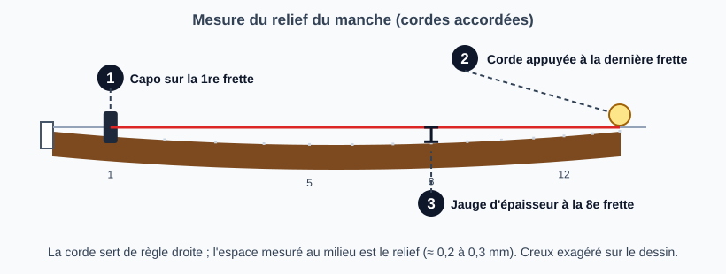

# Mesurer le relief du manche

> Le relief est la légère courbure du manche vers l'avant sous la tension des cordes. On le mesure
> avant toute autre retouche : c'est lui qui dit s'il faut toucher au truss rod. Les valeurs sont des
> points de départ à confirmer sur l'instrument et au goût du joueur.

## Risques et points de non-retour

- **Mesurer avec des cordes détendues ou usées** fausse tout : accorder d'abord.
- **Conclure trop vite sur le truss rod** : un relief correct avec une action trop haute ou une corde qui bourdonne ne se règle pas au truss rod (sillet, frette haute, manche tordu).
- **Mesure unique** : l'humidité et la température font bouger le manche, refaire la mesure à un autre moment.

## Outils et matériel

- Capo
- Jeu de jauges d'épaisseur (ou règle graduée en mm)
- Accordeur
- Cordes en bon état, accordées à leur tension de jeu

## Étapes

### 1. Accorder et laisser reposer

Mettre les cordes à leur tension normale, accorder, attendre quelques minutes.

### 2. Mesurer

1. Poser un capo sur la 1re frette.
2. Appuyer la corde de mi grave à la dernière frette (jonction manche/corps) : la corde devient une règle droite entre ces deux points.
3. Au milieu du manche (autour de la 8e frette), mesurer l'espace entre le dessous de la corde et le dessus de la frette, avec une jauge d'épaisseur.

### 3. Comparer aux valeurs cibles

Valeurs de départ (StewMac, « Typical starting points ») :

| Instrument | Relief visé | En mm |
|------------|-------------|-------|
| Électrique | 0,004 à 0,008 po | 0,10 à 0,20 mm |
| Acoustique | 0,006 à 0,012 po | 0,15 à 0,30 mm |
| Basse | 0,008 à 0,015 po | 0,20 à 0,38 mm |

Côté aigu, StewMac note que le manche aime souvent 0,001 à 0,002 po (0,03 à 0,05 mm) de moins que côté grave : mesurer les deux côtés.

Autres repères, moins fiables (à confirmer) :

- **Premier Guitar** : environ 0,010 po (0,25 mm) pour un joueur léger à moyen ; 0,015 à 0,020 po (0,38 à 0,51 mm) pour un joueur agressif ou avec un capo (article écrit sur une électrique).
- **Fender** (site tiers, non vérifié chez le constructeur) : 0,010 po (0,25 mm) pour un rayon de 9,5 à 12 po, 0,012 po (0,30 mm) pour 7,25 po, mesuré à la **8e frette**.
- **Taylor** (même site tiers) : 0,002 à 0,003 po (0,05 à 0,08 mm) à la 7e frette, corde tenue aux 1re et 14e frettes. Très inférieur aux autres : à vérifier dans la documentation du constructeur.

**Frette de mesure.** StewMac mesure à la 7e ou 8e frette ; Fender à la 8e ; Taylor à la 7e. **Aucune des sources lues ne cite la 10e frette.** Si l'atelier mesure à la 10e, on ne peut pas comparer directement ces valeurs : noter les mesures de l'atelier à la 10e et en faire ses propres références.

### 4. Lire le résultat

| Espace mesuré | Diagnostic | Action |
|---------------|------------|--------|
| dans la plage visée pour l'instrument | Relief correct | Ne pas toucher au truss rod, passer au sillet |
| nettement plus (corde loin de la frette) | Trop de relief : action haute, jeu mou | Serrer le truss rod |
| presque nul, ou la corde touche la frette | Pas assez de relief, ou manche en arrière : bourdonnements dans les premières frettes | Desserrer le truss rod |

La procédure de réglage est dans la fiche [Ajuster le truss rod](reglage-truss-rod.md) ; la suite des réglages dans [Ajuster l'action](reglage-action.md).

## Pièges et erreurs courantes

- Mesurer cordes détendues ou à l'envers de l'accord normal.
- Mesurer à un autre endroit que celui de la source suivie : les sources donnent la mesure à la 5e, 7e ou 8e frette selon l'auteur. Se fier d'abord aux spécifications du constructeur.
- Confondre relief et torsion du manche : le truss rod ne corrige pas une torsion.

## Vérifications finales

- [ ] Instrument accordé à la tension de jeu avant la mesure
- [ ] Valeur notée (sans elle, on ne sait pas dans quel sens corriger)
- [ ] Diagnostic noté : correct, trop de relief, pas assez

## Sources et liens

- [StewMac : How to measure neck relief on a guitar](https://stewmac.com/video-and-ideas/online-resources/neck-building-and-repair-and-setup/neck-relief-gauge-instructions) : valeurs de départ par type d'instrument, mesure à la 7e ou 8e frette, à la jauge d'épaisseur ou au comparateur.
- [Premier Guitar : Guitar neck relief](https://www.premierguitar.com/diy/guitar-shop-101/guitar-neck-relief) : mesure à la jauge d'épaisseur ; 0,010 po pour un joueur léger à moyen, 0,015 à 0,020 po pour un joueur agressif ou avec capo.
- [Owning a Fender : Setup specs lookup](https://owningafender.com/setup-specs-lookup) : valeurs attribuées à Fender (8e frette) et à Taylor (7e frette) ; site tiers non affilié, non vérifié chez les constructeurs.
- [Martin Guitar : SC13E setup adjustment (PDF)](https://www.martinguitar.com/on/demandware.static/-/Library-Sites-MartinSharedLibrary/default/pdf/sc13e-setup-adjustment.pdf) : relief mesuré à la 5e frette par un constructeur d'acoustiques.

> Les sources ne donnent pas les mêmes valeurs ni les mêmes points de mesure. Aucune vidéo n'est encore référencée. Le schéma exagère le creux du manche pour le rendre visible.

## Historique des révisions

| Date | Changement |
|------|------------|
| 2026-10-30 | Création du brouillon, extraite de l'étape 2 de la fiche « Ajuster l'action » ; schéma de mesure |
