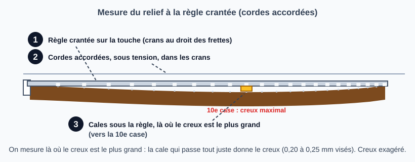
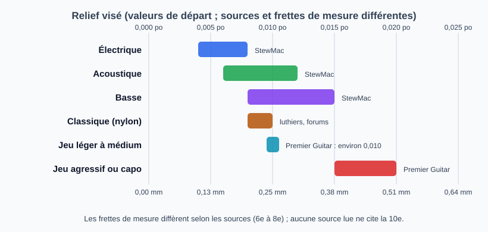

# Mesurer le relief du manche

> Le relief est la légère courbure du manche vers l'avant sous la tension des cordes. On le mesure
> avant toute autre retouche : c'est lui qui dit s'il faut toucher au truss rod. Les valeurs sont des
> points de départ à confirmer sur l'instrument et au goût du joueur.

## Risques et points de non-retour

- **Mesurer avec des cordes détendues ou usées** fausse tout : accorder d'abord.
- **Conclure trop vite sur le truss rod** : un relief correct avec une action trop haute ou une corde qui bourdonne ne se règle pas au truss rod (sillet, frette haute, manche tordu).
- **Mesure unique** : l'humidité et la température font bouger le manche, refaire la mesure à un autre moment.

## Outils et matériel

- Jeu de jauges d'épaisseur (ou « cales de mécanicien »)
- Méthode au capo : capo
- Méthode à la règle crantée : règle crantée (par exemple la Precision Notched Straightedge de StewMac, 420 mm pour les guitares, crans par échelle)
- Accordeur
- Cordes en bon état, accordées à leur tension de jeu

## Étapes

### 1. Accorder et laisser reposer

Mettre les cordes à leur tension normale, accorder, attendre quelques minutes.

### 2. Mesurer : deux méthodes

Les deux se font **cordes accordées et sous tension**. Elles ne donnent pas le même chiffre : ne pas mélanger leurs valeurs cibles (voir l'étape 3).

#### Méthode A : au capo (la corde sert de règle)

1. Poser un capo sur la 1re frette.
2. Appuyer la corde de mi grave à la dernière frette (jonction manche/corps ; au plus à la 17e selon Pirate Custom Guitar, au-delà le truss rod n'agit plus) : la corde devient une règle droite entre ces deux points.
3. Au milieu du manche (autour de la 7e ou 8e frette), mesurer l'espace entre le dessous de la corde et le dessus de la frette, avec une jauge d'épaisseur.

#### Méthode B : à la règle crantée (cales sous la règle)

1. Poser la règle crantée **sur la touche** : ses crans sont au droit des frettes (ils évitent de les toucher) et laissent passer les cordes.
2. Les cordes restent accordées, sous tension.
3. Glisser des cales de mécanicien **sous la règle, là où le creux est le plus grand (vers la 10e case)** : la cale la plus épaisse qui passe tout juste, sans soulever la règle, donne le creux.

Cette méthode mesure le creux de la touche elle-même (le bois), par rapport à la droite que forme la règle. StewMac la présente comme un outil pour contrôler la planéité de la touche, mesurer rapidement le relief, repérer les zones à problème et décider s'il faut toucher au truss rod. La mesure vers la 10e case et la cible de 0,20 à 0,25 mm viennent d'une vidéo de Pirate Custom Guitar (sous-titres générés automatiquement, à vérifier à l'écoute) et d'un luthier (Vincent Brun) qui donne la même fourchette sans citer la case. Aucun texte écrit n'a été trouvé pour décrire cette procédure.

### 3. Comparer aux valeurs cibles

**Méthode B, à la règle crantée (vers la 10e case)** : on vise une cale de **0,20 à 0,25 mm** qui passe tout juste sous la règle (Pirate Custom Guitar ; Vincent Brun donne la même fourchette sans citer la case). Ce sont des valeurs d'atelier, pas de constructeur, et la source de la mesure à la 10e est une vidéo : à confirmer.

**Méthode A, au capo : par type d'instrument** (valeurs de départ des sources anglophones, mesurées sur la corde) :

| Instrument | Relief visé | En mm | Frette de mesure | Source |
|------------|-------------|-------|------------------|--------|
| Électrique | 0,004 à 0,008 po | 0,10 à 0,20 | 7e ou 8e | StewMac, « Typical starting points » |
| Électrique | 0,006 po | 0,15 | 6e | MusicNomad (fabricant d'outils) |
| Acoustique | 0,006 à 0,012 po | 0,15 à 0,30 | 7e ou 8e | StewMac |
| Acoustique | 0,008 po | 0,20 | 6e | MusicNomad |
| Basse | 0,008 à 0,015 po | 0,20 à 0,38 | 7e ou 8e | StewMac |
| Classique (nylon) | 0,008 à 0,010 po | 0,20 à 0,25 | 7e (1re et 14e tenues) | luthiers et forum Delcamp |
| Classique (nylon) | 0,010 po | 0,25 | 6e | MusicNomad |

Côté aigu, StewMac note que le manche aime souvent 0,001 à 0,002 po (0,03 à 0,05 mm) de moins que côté grave : mesurer les deux côtés.

**Par style de jeu et conditions** (acoustique et électrique ; plus le jeu est puissant, plus on tolère de relief pour éviter les bourdonnements) :

| Condition | Relief visé | En mm | Source |
|-----------|-------------|-------|--------|
| Jeu léger à médium (strumming léger) | environ 0,010 po | 0,25 | Premier Guitar (John LeVan, réparateur) |
| Jeu agressif, ou capo utilisé | 0,015 à 0,020 po | 0,38 à 0,51 | Premier Guitar |
| Doigts (fingerstyle), acoustique | 0,010 à 0,015 po | 0,25 à 0,38 | Instrument Insight (blog) |
| Strumming léger, acoustique | 0,010 à 0,020 po | 0,25 à 0,51 | Instrument Insight (blog) |
| Strumming fort, acoustique | 0,010 à 0,025 po | 0,25 à 0,64 | Instrument Insight (blog) |

Les valeurs du blog Instrument Insight se contredisent entre sections (plage de 0,006 à 0,014 po ailleurs dans le même article) : repère indicatif seulement. Un joueur léger au toucher doux peut descendre vers le bas de la plage ; un joueur qui frappe fort ou qui utilise un capo monte vers le haut.

**Cordes.** Un jeu de cordes plus lourd ou plus tendu augmente la tension sur le manche et donc le relief (formulation qualitative des blogs et de Premier Guitar) : remesurer après tout changement de jauge. Aucune source lue ne donne de valeur chiffrée pour un accordage grave.

**Classique (nylon).** La plupart des guitares classiques n'ont pas de tige : le relief dépend de la tension des cordes, du manche (flèche prévue à la facture, surtout côté basses) et de l'humidité. Un luthier du forum Delcamp vise 0,008 po côté basses, 0,006 po sur la 4e corde et un manche plat côté aigu, avec l'essentiel du relief entre le sillet et la 7e frette ; un autre juge que le relief peut être « vraiment nul ». Se fier d'abord à la facture de l'instrument, et ne jamais forcer une tige sur une classique.

**Frette de mesure.** StewMac mesure à la 7e ou 8e frette ; Fender à la 8e (site tiers) ; Taylor à la 7e (même site tiers, 0,002 à 0,003 po : très inférieur aux autres, à vérifier chez le constructeur) ; MusicNomad à la 6e. **La 10e case n'est citée que pour la règle crantée** (vidéo de Pirate Custom Guitar). Les valeurs du tableau (méthode A) sont mesurées sur la corde, à la 6e à 8e frette : elles ne se transposent pas telles quelles à une lecture à la règle, qui compare la touche à une droite posée sur le bois et non à la corde. À chaque méthode ses valeurs ; garder la même méthode d'un réglage à l'autre pour comparer.

### 4. Lire le résultat

| Espace mesuré | Diagnostic | Action |
|---------------|------------|--------|
| dans la plage visée pour l'instrument | Relief correct | Ne pas toucher au truss rod, passer au sillet |
| nettement plus (corde loin de la frette) | Trop de relief : action haute, jeu mou | Serrer le truss rod |
| presque nul, ou la corde touche la frette | Pas assez de relief, ou manche en arrière : bourdonnements dans les premières frettes | Desserrer le truss rod |

La procédure de réglage est dans la fiche [Ajuster le truss rod](reglage-truss-rod.md) ; la suite des réglages dans [Ajuster l'action](reglage-action.md).

## Pièges et erreurs courantes

- Mesurer cordes détendues ou à l'envers de l'accord normal.
- Mesurer à un autre endroit que celui de la source suivie : les sources donnent la mesure à la 5e, 7e ou 8e frette selon l'auteur. Se fier d'abord aux spécifications du constructeur.
- Confondre relief et torsion du manche : le truss rod ne corrige pas une torsion.

## Vérifications finales

- [ ] Instrument accordé à la tension de jeu avant la mesure
- [ ] Valeur notée (sans elle, on ne sait pas dans quel sens corriger)
- [ ] Diagnostic noté : correct, trop de relief, pas assez

## Sources et liens

- [StewMac : How to measure neck relief on a guitar](https://stewmac.com/video-and-ideas/online-resources/neck-building-and-repair-and-setup/neck-relief-gauge-instructions) : valeurs de départ par type d'instrument, mesure à la 7e ou 8e frette, à la jauge d'épaisseur ou au comparateur.
- [Premier Guitar : Guitar neck relief](https://www.premierguitar.com/diy/guitar-shop-101/guitar-neck-relief) : mesure à la jauge d'épaisseur ; 0,010 po pour un joueur léger à moyen, 0,015 à 0,020 po pour un joueur agressif ou avec capo.
- [Pirate Custom Guitar : TRUSSROD guitare, COMMENT on le règle ? (vidéo)](https://www.youtube.com/watch?v=C8FBdvsmRBo) : méthode à la règle crantée et aux cales, « au niveau de la case 10 à peu près », cale de 0,20 à 0,25 mm (10:44 à 11:03) ; méthode au capo (7e ou 8e case, corde tenue au plus à la 17e) ; réglage du relief avant l'action. Sous-titres automatiques.
- [Vincent Brun, luthierdebutant.com : Entretenir et régler sa guitare](https://luthierdebutant.com/blog/2025/05/18/entretenir-et-regler-sa-guitare/) : courbure d'environ 0,15 mm « un peu bas », valeur habituelle de 0,20 à 0,25 mm ; sans case de mesure ni protocole.
- [StewMac : Precision Notched Straightedge](https://www.stewmac.com/luthier-tools-and-supplies/types-of-tools/straightedges/precision-notched-straightedge/) : règle présentée comme outil pour mesurer rapidement le relief et vérifier la planéité de la touche ; sans procédure.
- [MusicNomad : The complete guide to guitar neck relief](https://musicnomadcare.com/guides/the-complete-guide-to-guitar-neck-relief/) : valeurs par type (électrique 0,006 po, acoustique et basse 0,008 po, classique 0,010 po), mesure à la 6e frette, réglage du truss rod par pas de 1/8 de tour au plus ; fabricant d'outils, page sans auteur.
- [Delcamp Classical Guitar Forum : Neck relief](https://www.classicalguitardelcamp.com/viewtopic.php?t=72036) : relief d'une guitare classique selon des luthiers (0,008 po côté basses, plat côté aigu, relief possiblement nul) ; avis de forum.
- [Delcamp Classical Guitar Forum : Classical guitar neck relief ?](https://www.classicalguitardelcamp.com/viewtopic.php?t=22484) : 0,008 à 0,010 po à la 7e frette, 1re et 14e tenues, cordes à tension normale ; avis de forum.
- [Instrument Insight : How much neck relief acoustic guitar](https://instrumentinsight.com/?p=19598) : plages par style de jeu pour une acoustique ; blog, valeurs incohérentes entre sections.
- [Owning a Fender : Setup specs lookup](https://owningafender.com/setup-specs-lookup) : valeurs attribuées à Fender (8e frette) et à Taylor (7e frette) ; site tiers non affilié, non vérifié chez les constructeurs.
- [Martin Guitar : SC13E setup adjustment (PDF)](https://www.martinguitar.com/on/demandware.static/-/Library-Sites-MartinSharedLibrary/default/pdf/sc13e-setup-adjustment.pdf) : relief mesuré à la 5e frette par un constructeur d'acoustiques.

> Les sources ne donnent pas les mêmes valeurs ni les mêmes points de mesure. Aucune vidéo n'est encore référencée. Le schéma exagère le creux du manche pour le rendre visible.

## Historique des révisions

| Date | Changement |
|------|------------|
| 2026-10-30 | Création du brouillon, extraite de l'étape 2 de la fiche « Ajuster l'action » ; schéma de mesure |
| 2026-10-30 | Valeurs cibles par instrument et style de jeu, avec graphique |
| 2026-10-30 | Deux méthodes de mesure : au capo et à la règle crantée (cales sous la règle, vers la 10e case, cible 0,20 à 0,25 mm) ; schéma de la règle ; conversion « 70 % » non sourcée retirée |
