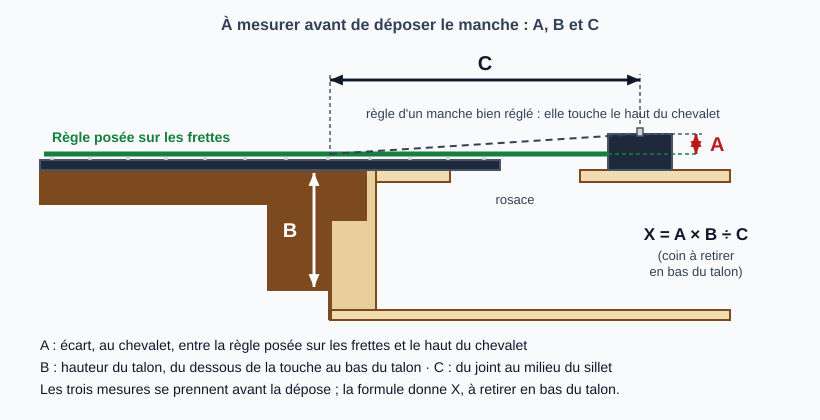
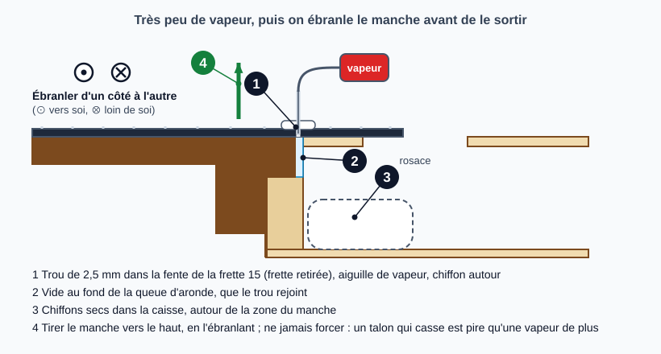
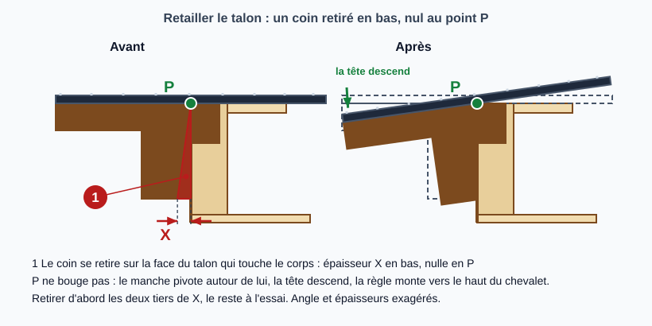

# Refaire l'angle d'un manche collé en queue d'aronde : dépose, retaille du talon, recollage

> Quand l'angle d'un manche collé est trop faible, on le dépose à la vapeur, on retire un coin de bois en bas du talon et on le recolle. C'est l'opération la plus délicate de la série.
> Suite de la fiche maîtresse [Refaire l'angle du manche (neck reset)](refaire-angle-du-manche.md), cas « manche collé » ; la rallonge de touche se traite dans [Décoller la rallonge de touche de la table](decoller-la-touche.md) puis [Caler la rallonge de touche](caler-la-rallonge-de-touche.md).

## Risques et points de non-retour

- **Le talon peut casser.** Les cales d'origine et les poches de colle au fond de la queue d'aronde peuvent retenir le manche et le talon cède plutôt que le joint (Dave Johnson, Guitar Craft Academy Nashville : « ne cassez pas le talon »). Une guitare très collée, comme certaines Guild, demande encore plus de précautions (Crawls Backward, qui le rapporte d'après Dan Erlewine).
- **La vapeur abîme le vernis et le bois.** Elle peut ternir le vernis (Dave Johnson : « blush ») ; il faut un minimum de vapeur et protéger la caisse (Haze Guitars, Forsyth).
- **Retirer du bois est irréversible.** On retire d'abord les deux tiers de la quantité calculée et on termine à l'essai (Haze Guitars) ; trop retirer oblige à caler le talon (atelier, non sourcé).
- **Le point P ne doit pas bouger** (jonction touche, côté et table) : sinon les frettes se décalent par rapport au sillet de chevalet et la justesse en souffre (Haze Guitars).
- **Un refrettage est à prévoir, et un nouveau sillet de chevalet est pratiquement sûr** (Haze Guitars) : à budgéter avant de commencer.
- **Sur un instrument de valeur ou sans expérience, ne pas tenter** : la fiche maîtresse le rappelle.
- **Brûlures** (atelier, non sourcé) : la vapeur sort de l'aiguille et du trou, et peut encore cracher quand on retire l'aiguille (Haze Guitars). Voir l'étape 4.

## Outils et matériel

- Pour mesurer : règle de précision, grande règle droite (plus longue que la touche), pied à coulisse, ruban de masquage peu collant
- Pour déposer : générateur de vapeur avec aiguille (celle de Haze Guitars fait 5/64 po, soit environ 2 mm ; il perce à 2,5 mm pour la laisser passer) ou espresso avec tube et aiguille (Frank Ford utilise une cafetière espresso et une aiguille inox de 1/16 po, environ 1,6 mm), perceuse avec une mèche de 2,5 mm (ou 1/16 po chez Frank Ford), gants, chiffons secs et éponges, un étau à manche (utile, pas indispensable : Haze Guitars), éventuellement un gabarit de dépose (barres filetées, contreplaqué et un boulon à molette ; Haze Guitars le juge utile mais « pas indispensable » : [Neck Resets 4](https://hazeguitars.com/blog/useful-neck-reset-tools)) et un aspirateur à la rosace (Haze Guitars, Dave Johnson, Frank Ford)
- Pour retailler : ciseau à bois bien affûté, **bâton de ponçage** plat et rigide d'environ 20 à 25 mm de large et 150 à 200 mm de long avec du papier grain 120 (Haze Guitars), bandes de papier de verre de 25 mm environ en grains 120, 220 et 320, ruban de peintre
- Pour recoller : colle de peau fraîche, bain-marie ou pot à colle, carton fin (non glacé) puis cales de bois, papier carbone, jauge d'épaisseur, serre-joints, cales de serrage (une fendue pour passer les frettes, une en liège, légèrement en coin)
- Pour finir : bois dur (palissandre ou ébène) pour le bouchon, scie à frette, matériel de refrettage

## Étapes

### 1. Mesurer avant de déposer

Trois mesures sont nécessaires, et **au moins A doit être prise avant la dépose** (Haze Guitars demande qu'une des mesures le soit) : les prendre toutes les trois tant que le manche est en place. Guitare accordée et à humidité normale (atelier, non sourcé : la table gonflée ou creusée change la hauteur du chevalet ; voir [Retrouver une humidité normale](retrouver-humidite-normale.md)). Poser une grande règle droite sur le dessus des frettes, son bout contre le chevalet : un manche bien réglé la fait toucher le chevalet **tout en haut**. Si elle touche plus bas, le manche est trop bas, et cet écart est **A**. Puis mesurer **B**, la hauteur du talon, du dessous de la touche à l'extrémité du talon, et **C**, la distance du joint manche/corps au milieu du sillet de chevalet (entre les cordes de ré et de sol). La quantité à retirer en bas du talon vaut :

**X = A × B ÷ C**

La formule est un rapport : n'importe quelle unité convient, pourvu que ce soit la même pour A, B et C (Haze Guitars conseille les millimètres). Haze Guitars ne donne aucune formule pour un manche trop haut, et fournit une feuille de calcul en ligne. Ce n'est qu'une première estimation : l'angle final se règle à l'essai (étape 6).

### 2. Préparer la dépose

- **Retirer la frette 15** : sur une guitare à 14 frettes au corps, le fond de la queue d'aronde est sous la 15e frette (Haze Guitars) ; Crawls Backward la retire aussi, et elle sort sans éclat. Sur une guitare à 12 frettes au corps ou un petit instrument, ce n'est pas la 15e : chercher où finit la mortaise (atelier, non sourcé ; la fiche « Décoller la rallonge » cite la 13e sur un ténor).
- **Libérer la rallonge de touche** : voir [Décoller la rallonge de touche de la table](decoller-la-touche.md). Haze Guitars ne scie la rallonge à travers la fente de la 14e frette qu'en dernier recours.
- **Entailler le joint de vernis** autour du talon à la lame, et si le vernis est posé après l'assemblage (Guild), le ramollir au diluant au niveau du joint (Crawls Backward).
- Le détail du desserrage des cordes n'est pas décrit dans les sources : détendre les cordes et les retirer est le geste évident (atelier, non sourcé).

### 3. Percer l'accès à la queue d'aronde

Dans la fente de la frette 15, percer un trou de **2,5 mm environ**, à un tiers de la largeur du manche depuis le côté des basses, incliné légèrement vers le centre comme la queue d'aronde. S'il ne débouche pas dans le vide derrière le tenon, essayer un second trou à un tiers du côté des aigus. On sent le vide à la mèche, ou on le sonde avec le bout d'une corde (Haze Guitars). Frank Ford perce lui aussi dans la fente de la 15e frette, mais avec 1/16 po (environ 1,6 mm), et sonde avec une vieille corde. Dave Johnson perce plusieurs trous le long de la poche. Une butée de profondeur sur la mèche évite de déboucher sous le talon (atelier, non sourcé).

### 4. Vapeur, puis dépose

Mettre des chiffons secs dans la caisse autour du talon et garder des chiffons pour la vapeur qui s'échappe. Jeter d'abord l'eau qui crache, puis envoyer **quelques secondes** de vapeur par l'aiguille (Haze Guitars), ou « 3 ou 4 brèves bouffées » (Dave Johnson, qui commence par injecter de l'eau chaude avec une seringue, sans « détremper » la poche). **Le moins de vapeur possible** (Haze Guitars, Dave Johnson, Forsyth : « il n'en faut pas beaucoup »). On ébranle d'abord le manche des basses vers les aigus ; quand il commence à céder, on ajoute une traction vers le haut, en sortant le manche de la guitare (Haze Guitars). On le sent « donner » avant de partir, et il peut partir d'un coup : le tenir. Un gabarit de dépose ou des serre-joints à came aident à exercer une poussée douce, sans forcer. Forsyth travaille à deux : l'un dirige la vapeur, l'autre arrête les projections avec du papier absorbant et éponge. Frank Ford chauffe aussi la touche avec une résistance en caoutchouc sur minuterie (aluminium pour garder la résistance propre, lame de bois de 1/8 po, environ 3 mm, en isolant ; il chauffe jusqu'à sentir une vraie chaleur à l'intérieur), et le manche, lui, saute libre au gabarit après environ 1/2 po (13 mm) de course.

**Si le joint résiste**, ne pas augmenter la force : laisser sécher, recommencer la vapeur par petites séances (Crawls Backward : environ 15 minutes de vapeur étalées sur deux soirs sur une Guild) ; Haze Guitars décrit aussi une rallonge de fer à souder, le « HeatStick » ([Neck Resets 4](https://hazeguitars.com/blog/useful-neck-reset-tools)) : chaleur sèche à la place de la vapeur, trou plus grand, peu de roussi observé mais des premiers retours de bois roussi au bloc et à la table ; Haze doutait au départ que la chaleur sèche pénètre aussi bien que la vapeur ; il l'a d'abord employée en dernier recours sur un talon cassé, puis quelques fois depuis. Frank Ford ([Air Harness](https://www.frets.com/FretsPages/Luthier/Tools/AirHarness/airharness.html)) souffle de l'air froid sur le vernis pendant la vapeur, utile sur un vernis fragile ou un joint tenace.

**Sécurité** (atelier, non sourcé, sauf la vapeur résiduelle signalée par Haze Guitars) : gants ; ni le visage ni la main dans l'axe de l'aiguille ; couper la vapeur avant de retirer l'aiguille, qui peut encore cracher ; tenir le manche, il peut partir d'un coup.

Ce que les sources ne donnent pas : température, pression de vapeur, durée totale « normale ».

### 5. Nettoyer et laisser sécher

Éponger l'eau condensée. Gratter la colle sur les deux faces du joint pendant qu'elle est encore chaude (Haze Guitars). Poser le manche à part et le laisser **sécher à fond** avant de toucher à l'angle (Forsyth).

### 6. Retailler le talon

Le principe : on retire un coin au bas du talon, d'épaisseur X en bas, qui s'annule vers le point P. P ne doit pas bouger.

**Retaille grossière (Haze Guitars).**
0. Au ciseau, creuser légèrement la face du talon en laissant une lisière étroite sur le pourtour, seule en contact avec les éclisses ; recreuser si la lisière s'élargit (Haze Guitars). C'est elle qu'on retaille ensuite.
1. Mesurer X au pied à coulisse et le marquer au ruban, **mais ne marquer que les deux tiers environ** (ou tout marquer en s'interdisant d'aller jusqu'au bout).
2. Manche serré dans l'étau, travailler un côté puis l'autre avec le bâton de ponçage plat, grain 120, en butée contre la touche : presque rien n'est retiré à l'intersection talon/touche. Un ciseau est possible si l'on est sûr de soi.
3. Faire disparaître l'« île » qui reste au centre du talon, au bâton ou au ciseau, au même niveau que les côtés.

**Retaille fine (Haze Guitars).** Elle peut même remplacer la grossière, en plus long.
1. Ruban de peintre sur le corps de chaque côté du talon. Bandes de papier de verre de 25 mm environ, d'abord en grain 120, puis 220 en approchant de l'angle voulu, 320 à la fin.
2. Manche engagé à blanc dans la queue d'aronde, glisser une bande entre le talon et le côté, abrasif vers le manche, puis la **tirer vers l'extérieur et vers le bas** (sinon on ponce une rampe dans le bas du talon). Une ou deux passes d'un côté, autant de l'autre, puis quelques passes courtes au bout du talon pour supprimer l'île.
3. **Contrôler la ligne centrale** : règle du milieu du sillet de tête au milieu de la dernière frette, jusqu'au milieu du chevalet (entre les chevilles de ré et de sol) ; si elle dérive vers les basses, retirer un peu plus du côté basses du talon, et inversement.
4. **Contrôler l'angle** : la règle sur les frettes doit toucher le chevalet tout en haut. Environ six passes par côté avant de changer de bande ; les lignes centrales dérivent, il faut les revérifier souvent.

À l'écaillage du vernis au bord du talon, Haze Guitars passe un fil très fin de diluant.

**Où retirer le bois.** Le coin se retire sur le talon, jamais à la pointe du coin côté touche, ce qui changerait la longueur de diapason (Haze Guitars, [Martin Neck Reset - Easy](https://hazeguitars.com/blog/martin-neck-reset-easy)). Frank Ford ne retaille pas toute la face : comme à l'étape 0, il ne garde qu'une lisière d'appui, environ 1/16 po (1,6 mm) de la surface d'origine. Sa conicité part d'environ 1/32 po (0,8 mm) de profondeur au bas du talon, valeur propre à sa 000-28, pas une règle, et s'arrête à environ 1/4 po (6 mm) sous la touche, donc avant P (le coin y est déjà négligeable) ; il ajuste ensuite au papier 180 tiré dans le joint. Crawls Backward ([1931 Martin 0-18T](https://crawlsbackward.blogspot.com/2016/10/neck-heel-trimming-and-reset-1931.html)) trace un peu en dessous de la quantité voulue et ponce au bâton (60 d'un côté, 100 ou 120 de l'autre), jugé plus précis que le ciseau, qui sert à retirer la bosse du bas du talon ; sur cette guitare la quantité était de 0,040 po (environ 1 mm), valeur propre à elle, pas une règle.

### 7. Essayer à blanc, régler la queue d'aronde

Une fois l'angle atteint, le manche ne rentre plus comme avant (atelier, non sourcé) : le jeu de la queue d'aronde se rattrape avec des cales (Haze Guitars, partie 8).

- **Cale provisoire** : du carton fin non glacé ou du papier, empilé jusqu'à ce que la queue d'aronde « accroche » juste avant que le manche soit entièrement en place.
- **Jeu sous la rallonge** : manche enfoncé à la main, environ **0,5 mm** (0,020 po) entre le dessous de la rallonge de touche et la table, **près du joint** et égal des deux côtés, mesuré avec une jauge d'épaisseur (Haze Guitars).
- **Décider de la rallonge maintenant, pas après le collage** : manche serré à blanc, mesurer aussi l'écart sous le bout de la rallonge. Selon cet écart, on la recolle à plat ou on prépare une cale en coin **avant** de coller le manche : voir [Caler la rallonge de touche](caler-la-rallonge-de-touche.md). Les deux mesures sont distinctes : le jeu de 0,5 mm près du joint, l'écart au bout de la rallonge.
- **Cale définitive** : mesurer la cale de carton, y ajouter environ 0,25 mm, et la coller en bois contre la paroi de la queue d'aronde femelle, du même côté que les cales provisoires. Laisser prendre la colle de la cale avant l'ajustement final.
- **Ajustement** : papier carbone entre la cale et la queue d'aronde mâle, pression à la main, racler ou ciseler les points hauts ; recommencer plusieurs fois. Comparer le jeu côté basses et côté aigus : si l'un est plus faible, le manche est de travers, et on retire un peu de matière sur les faces de la queue d'aronde **mâle**, au bâton de ponçage, puis on réessaie, jusqu'à environ 0,5 mm des deux côtés.

### 8. Recoller

La colle recommandée est la **colle de peau** (Haze Guitars, Dave Johnson) ; Haze Guitars déconseille la colle de peau en bouteille, et si on l'emploie il faut qu'elle soit fraîche (date de péremption). Les sources ne détaillent ni la température, ni le dosage, ni le temps ouvert : à documenter à l'atelier.

**Répéter le serrage à blanc avant d'encoller** : la colle de peau chaude fige vite (atelier, non sourcé).

- Sur une Martin, la colle va **seulement sur les faces de la queue d'aronde** (« seulement dans le joint ») et sous la rallonge de touche ; le talon n'est pas collé au corps. Sur une Gibson, le talon est collé aussi (Haze Guitars).
- Serrer **un serre-joint sur la queue d'aronde**, et **un second par la rosace** pour la rallonge (avec une cale qui s'adapte à la barre d'épaule), la cale du dessus étant fendue pour passer les frettes (Haze Guitars).
- Frank Ford ne met la colle de peau, au pinceau, que sur les côtés du joint, colle ses cales de queue d'aronde (placage ou fibre fine) en même temps que le manche (autre école que l'étape 7, où l'on laisse prendre la colle de la cale avant l'ajustement), et serre la touche avec une cale taillée au rayon de la touche. Haze Guitars ([Martin Neck Reset - Easy](https://hazeguitars.com/blog/martin-neck-reset-easy)) résume : un serre-joint pour le joint, un pour la touche, et une nuit (que Haze juge peut-être excessive, mais rassurante ; Ford ne donne pas de durée). Aucune des sources lues ne donne la force de serrage.
- Contrôler encore la ligne centrale, nettoyer le surplus de colle, laisser **une nuit**.

### 9. Finir

- **Bouchon** : tailler un rond légèrement conique dans du palissandre ou de l'ébène, le coller dans le trou, l'araser à la touche, puis refaire la fente de frette (scie à frette).
- **Rallonge de touche** : collée à l'étape 8, à plat ou sur sa cale (décidé à l'étape 7) ; vérifier qu'elle ne se plie pas. Si la remise en angle est modeste, la serrer sur la table donne une légère chute supplémentaire ; pour un angle plus grand, une cale est nécessaire (Haze Guitars) : voir [Caler la rallonge de touche](caler-la-rallonge-de-touche.md). Frank Ford, lui, préfère garder une légère chute de la rallonge plutôt que de glisser une cale dessous : pour lui, une cale sous le bout de la touche donne un aspect irrégulier. Les deux écoles existent, à choisir selon l'écart mesuré à l'étape 7.
- **Frettes** : si la chance sourit, on remet la frette retirée et on égalise légèrement ; sinon on retire les frettes, on met la touche à niveau et on refrette (Haze Guitars conseille de le prévoir dans le budget même s'il n'est pas toujours nécessaire).
- **Sillet de chevalet** : un nouveau est pratiquement sûr. Un nouveau sillet de tête peut aussi être nécessaire après un refrettage.
- **Retouche de vernis** : la nitro doit durcir **au minimum une semaine**, plutôt deux (Haze Guitars).
- Puis mettre le manche droit au truss rod, régler le relief et l'action (voir [Ajuster l'action](reglage-action.md)).

## Pièges et erreurs courantes

- Ne pas mesurer A avant la dépose (impossible après).
- Décider de la rallonge (à plat ou avec une cale) après le collage du manche : trop tard.
- Coller sans avoir répété le serrage à blanc.
- Faire bouger le point P en ponçant trop près de la touche.
- Tirer le bâton ou la bande vers le talon : cela creuse une rampe.
- Nombre de passes différent de chaque côté : le manche se tord.
- Oublier de contrôler la ligne centrale après chaque série de passes.
- Trop de vapeur : vernis terni, bois détrempé.
- Forcer sur un talon qui retient : il casse (Dave Johnson).
- Cales trop lisses ou carton glacé : le manche glisse hors de la queue d'aronde après le serrage.
- Colle de peau périmée.
- Ne pas budgéter refrettage et sillet.

## Vérifications finales

- [ ] Règle sur les frettes : touche le chevalet tout en haut
- [ ] Ligne centrale droite : sillet de tête, dernière frette, chevalet
- [ ] Queue d'aronde serrée, sans jeu ; talon contre les éclisses sans vide visible
- [ ] Rallonge de touche collée à la table, sans contrainte visible
- [ ] Relief correct, action dans la cible avec une marge au sillet de chevalet
- [ ] Frettes nivelées, justesse contrôlée
- [ ] Retouche de vernis durcie (au moins une semaine pour la nitro)

## Sources et liens

- [Haze Guitars : Neck Resets 3, Steaming out the neck](https://hazeguitars.com/blog/neck-reset-steaming-off-the-neck) : trou de 2,5 mm, quelques secondes de vapeur, chiffons, ébranler des basses vers les aigus puis tirer vers le haut, étau à manche utile mais pas indispensable.
- [Haze Guitars : Neck Resets 5, FIRST, We Measure](https://hazeguitars.com/blog/neck-resets-first-we-measure) : mesures A, B, C avant la dépose et formule X = A × B ÷ C.
- [Haze Guitars : Neck Resets 6, The Gross Reset](https://hazeguitars.com/blog/neck-resets-the-gross-reset) : le point P ne bouge pas, deux tiers de X au bâton de ponçage grain 120.
- [Haze Guitars : Neck Resets 7, The Fine Reset](https://hazeguitars.com/blog/neck-reset-the-fine-reset) : bandes de papier 120, 220, 320, ligne centrale et angle contrôlés à chaque série.
- [Haze Guitars : Neck Resets 8, Putting it all back together](https://hazeguitars.com/blog/neck-reset-putting-it-back-together) : cales de la queue d'aronde, jeu d'environ 0,5 mm, colle de peau, serrage.
- [Haze Guitars : Neck Resets 9, Finishing up](https://hazeguitars.com/blog/neck-resets-finishing-up) : bouchon, rallonge, frettes, sillet, vernis.
- [Guitar Craft Academy Nashville : Steaming out the heel of an OM-18 (Dave Johnson)](https://nashville.mi.edu/tech-tip-from-dave-johnson-steaming-out-the-heel-of-an-om-18/) : eau chaude puis bouffées de vapeur, gabarit, « ne cassez pas le talon », colle de peau.
- [Forsyth Music Shop : Workshop Diary, Resetting The Neck On A Fylde Guitar](https://www.forsyths.co.uk/blog/814-workshop-diary-resetting-the-neck-on-a-fylde-guitar) : dépose à deux avec serre-joints à came, éviter de saturer la guitare, sécher le manche.
- [Crawls Backward : Guild F-50 Neck Reset Begins](https://crawlsbackward.blogspot.com/2013/02/guild-f-50-neck-reset-begins.html) : vernis entaillé, frette 15 retirée, environ 15 minutes de vapeur sur deux nuits, éviter la pression sur le talon.
- [Frank Ford (frets.com) : Martin 000-28 neck reset, page 1](https://www.frets.com/FretsPages/Luthier/Technique/Guitar/NeckReset/00028Reset/00028reset01.html) : fond de la queue d'aronde sous la frette 15, trou de 1/16 po sondé à la corde, vapeur espresso, chauffage de la touche, gabarit de dépose.
- [Frank Ford (frets.com) : Martin 000-28 neck reset, page 2](https://www.frets.com/FretsPages/Luthier/Technique/Guitar/NeckReset/00028Reset/00028reset02.html) : conicité du talon, règle « en haut du chevalet, pas du sillet », colle sur les côtés du joint, cales de queue d'aronde, cale de serrage.
- [Frank Ford (frets.com) : Air Harness](https://www.frets.com/FretsPages/Luthier/Tools/AirHarness/airharness.html) : jet d'air comprimé qui refroidit le vernis pendant la vapeur.
- [Haze Guitars : Neck Resets 4, Useful Neck Reset Tools](https://hazeguitars.com/blog/useful-neck-reset-tools) : gabarit de dépose « pas indispensable », HeatStick (rallonge de fer à souder), ses limites.
- [Haze Guitars : Martin Neck Reset - Easy](https://hazeguitars.com/blog/martin-neck-reset-easy) : coin retiré au talon et non à la pointe, colle seulement sur la queue d'aronde et sous la touche, un serre-joint pour le joint et un pour la touche.
- [Crawls Backward : Trimming the Neck Heel for Reset, 1931 Martin 0-18T](https://crawlsbackward.blogspot.com/2016/10/neck-heel-trimming-and-reset-1931.html) : coin triangulaire qui s'annule en haut, bâton de ponçage plus précis que le ciseau, exemple chiffré de 0,040 po.

> Les sources ne donnent ni température ni pression de vapeur, ni dosage ni température de la colle de peau, ni temps de prise avant la remise des cordes en tension, ni formule pour un manche trop haut. Le desserrage des cordes et la remise en tension sont des gestes d'atelier, non sourcés ici. Les pages de StewMac (correction de l'angle, HeatStick) n'ont pas été lues en texte brut (seulement par résumé) et ne sont pas citées : leurs durées et réglages du HeatStick sont à vérifier avant tout usage. L'article de la série Haze Guitars sur le joint de vernis a été lu par le relecteur mais n'est pas listé : son adresse exacte n'a pas été retrouvée.

## Historique des révisions

| Date | Changement |
|------|------------|
| 2026-11-02 | Création du brouillon (4 schémas) ; sources : Haze Guitars (6 pages), Guitar Craft Academy Nashville, Forsyth, Crawls Backward |
| 2026-11-03 | Schémas refaits sur une coupe commune (`_banque/coupe.py`). Relecture Opus : conversion de l'aiguille (5/64 po ≈ 2 mm) ; décision sur la rallonge remontée à l'étape 7 ; sécurité vapeur ; ordre de l'ébranlement ; lisière du talon ; serrage à blanc ; attributions corrigées (Guild, frette 15, vernis) |
| 2026-11-04 | Nouvelles sources : Frank Ford (frets.com, 3 pages), Haze Guitars (Neck Resets 4, Martin Neck Reset - Easy), Crawls Backward 2016 ; variantes de perçage, HeatStick, conicité du talon, colle et serrage, rallonge sans cale ; le HeatStick de StewMac n'est pas cité (lu par résumé) |
