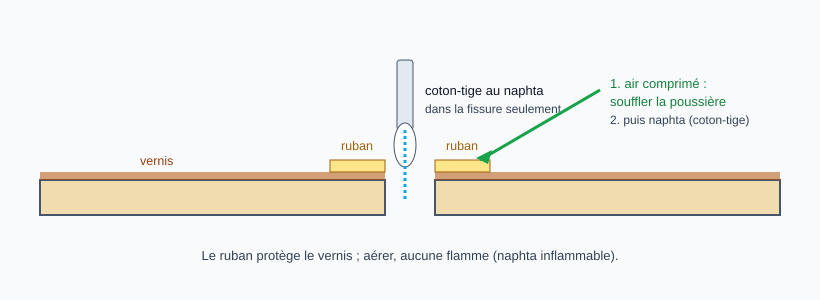

# Nettoyer et dégraisser une fissure avant collage

> Une colle ne prend pas sur de la poussière, de la graisse ou du vernis écaillé. On nettoie l'intérieur de la
> fissure (air comprimé, puis naphta), en protégeant le vernis tout autour. Le produit et les gestes viennent de
> pratiques de luthiers, à confirmer avec l'atelier.

## Risques et points de non-retour

- **Naphta inflammable** : aérer, aucune flamme, aucune étincelle, chiffons à laisser sécher à l'air libre.
- **Produit sur le vernis** : un solvant peut ternir ou ramollir une finition fragile ; tester d'abord sur une zone cachée et ne pas en laisser couler hors de la fissure.
- **Graisse ou silicone laissés dans la fissure** (polish, nettoyant ménager, huile de doigts) : la colle n'accroche pas, la réparation lâche.
- **Élargir la fissure** en grattant : nettoyer sans lever les fibres.

## Outils et matériel

- Air comprimé (bombe ou pistolet, pression modérée)
- Naphta : essence à briquet type Zippo, essence « F » ou combustible de lampe Coleman
- Coton-tiges ou petit pinceau, chiffon propre sans peluches
- Ruban de masquage ou ruban de protection à faible adhérence
- Lampe pour voir dans la fissure

## Étapes

### 1. Protéger le vernis

Poser le ruban de chaque côté de la fissure, au plus près des lèvres.

### 2. Souffler la poussière

Chasser la poussière et les éclats de vernis hors de la fissure à l'air comprimé, sans écarter les lèvres de force.

### 3. Dégraisser au naphta

Passer un coton-tige à peine humide de naphta **dans** la fissure, en une ou deux passes, puis laisser évaporer. Un luthier du Luthiers Forum donne le naphta et le white spirit (mineral spirits) comme interchangeables
et insiste pour se laver les mains avant, afin de ne pas pousser de saleté dans la fissure. Ne pas insister : le but est une surface propre,
pas une fissure plus large.

### 4. Laisser sécher puis coller

Attendre l'évaporation complète avant d'injecter la colle (voir la fiche [Réparer une fissure dans la table](reparation-fissure-table.md)).

## Pièges et erreurs courantes

- Utiliser un polish, un nettoyant ménager ou un produit contenant du silicone.
- Détremper la fissure : le naphta se met au coton-tige, pas à la bouteille.
- Coller avant l'évaporation complète.
- Oublier le ruban de protection autour de la fissure.

## Vérifications finales

- [ ] Plus de poussière visible dans la fissure à la lampe
- [ ] Naphta évaporé (plus d'odeur marquée, surface sèche)
- [ ] Vernis voisin intact, ruban encore en place avant le collage

## Sources et liens

- [StewMac : Crack repair tool instructions](https://www.stewmac.com/video-and-ideas/online-resources/learn-about-repair-tools-and-repair-techniques/stewmac-crack-repair-tool-instructions) : nettoyage de la fissure à l'air comprimé avant la réparation.
- [Luthiers Forum : Cordoba body crack repair suggestions](https://luthiersforum.com/forum/viewtopic.php?p=732734) : naphta ou white spirit interchangeables sur une fissure, mains propres pour ne pas pousser de saleté dedans.
- [StewMac : Simple trick for repairing cracks on a guitar fretboard](https://www.stewmac.com/video-and-ideas/online-resources/learn-about-guitar-and-instrument-fretting-and-fretwork/simple-trick-for-repairing-cracks-on-a-guitar-fretboard/) : nettoyage de la fissure au chiffon imbibé de naphta (cas d'une touche).

> Le naphta vient d'un technicien StewMac (réparation d'une touche) et d'un fil du Luthiers Forum, où il sert surtout à vérifier qu'une fissure traverse la table (une goutte au compte-gouttes, on regarde si la tache apparaît à l'intérieur). Les équivalents
> français (essence à briquet, essence F) sont indiqués d'après l'usage courant, non d'une source. Aucune des sources lues ne parle de rinçage à l'eau distillée ni de TSP : retirés. À confirmer avec l'atelier.

## Historique des révisions

| Date | Changement |
|------|------------|
| 2026-10-30 | Création du brouillon, extraite de l'étape « Protéger et préparer » de la fiche sur la fissure de table |
