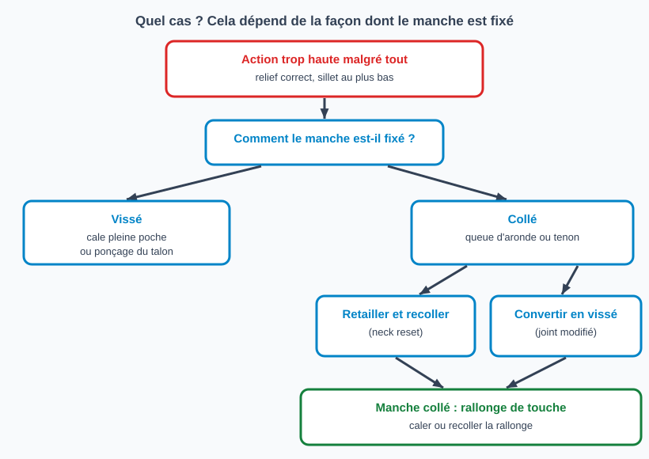

# Refaire l'angle du manche (neck reset) : quel cas, dans quel ordre

> Quand l'action reste trop haute alors que le relief est correct et que le sillet de chevalet est déjà au plus bas, c'est souvent l'angle du manche qu'il faut corriger.
> Fiche maîtresse : elle aide à reconnaître le cas et renvoie à la fiche détaillée de chaque opération, sans les répéter (pas de section « Outils » ni « Étapes » : chaque fiche liée a les siennes).

## Risques et points de non-retour

- **Manche collé** : la dépose à la vapeur ou à la chaleur peut abîmer la finition, la table et le joint. Un manche qui résiste à la dépose peut casser ou arracher la table : à ne pas tenter sur un instrument de valeur sans expérience.
- **Conversion en vissé** : irréversible, elle modifie le talon et la valeur de collection de l'instrument.
- **Travail de frettes presque toujours nécessaire ensuite** (Haze Guitars) : nivellement, surtout à la jonction avec le corps et sur la rallonge, voire refrettage.

## Reconnaître le cas

Le signe courant : le sillet de chevalet a déjà été abaissé plusieurs fois et l'action reste haute, le jeu devient inconfortable (Haze Guitars). Avant de conclure, **essayer ce qui est plus simple** :

1. Corriger le relief au truss rod (voir [Ajuster le truss rod](reglage-truss-rod.md) et [Mesurer le relief du manche](mesurer-relief-manche.md)).
2. Abaisser le sillet de chevalet (voir [Régler la hauteur des cordes au chevalet](regler-hauteur-chevalet.md)).
3. Vérifier que la table n'est pas bombée derrière le chevalet ou affaissée, et que le chevalet ne se décolle pas : ces défauts donnent aussi une action haute et demandent une autre réparation (contrôle d'atelier, non sourcé).

Forsyth Music Shop décrit ces essais : relief au truss rod, puis hauteur des cordes au sillet. Raboter le chevalet ou la touche, autrefois répandu, n'est pas recommandé (Forsyth).

> Tests chiffrés de diagnostic (règle posée sur la touche qui vise le chevalet, hauteur résiduelle du sillet) : **aucune des sources lues n'en publie**. À compléter depuis la pratique d'atelier.

## Quel cas ?

| Fixation du manche | Opération | Fiche |
|---|---|---|
| Vissé (électrique, quelques acoustiques) | Cale pleine poche ou ponçage du talon | fiche à venir |
| Collé (queue d'aronde ou tenon) | Déposer le manche, retailler, recoller | fiche à venir |
| Collé, converti en vissé | Modifier le joint pour le visser | fiche à venir |

**Manche vissé.** Le cas le plus simple. Une cale en coin pleine poche, en érable fin, est la méthode usuelle ; l'angle d'un manche vissé se situe généralement entre 0 et 5 degrés (Premier Guitar). Une cale partielle (carton, bout de plectre) laisse un vide sous le talon : le serrage des vis met le talon en contrainte et le contact manche-corps est moins bon. Le ponçage du talon est une pratique d'atelier, non sourcée ici. Haze Guitars range les Taylor NT parmi les guitares les plus faciles à remettre en angle.

**Manche collé.** C'est le cas qui demande le plus de matériel et d'expérience. Haze Guitars signale les Martin et Gibson comme des dépose à la vapeur et les Guild comme les plus délicates.

## Ordre des opérations (manche collé)

1. Décoller la rallonge de touche de la table (fiche à venir).
2. Déposer le manche (fiche à venir).
3. Retailler le talon à la nouvelle inclinaison (fiche à venir).
4. Essayer le manche à blanc et mesurer l'écart sous la rallonge, puis recoller le manche (fiche à venir).
5. Recoller ou caler la rallonge de touche : voir [Caler la rallonge de touche après un neck reset](caler-la-rallonge-de-touche.md).
6. Mettre le manche droit au truss rod, niveler les frettes, régler le relief puis l'action (voir [Ajuster l'action](reglage-action.md)).

## Pièges et erreurs courantes

- Conclure à un neck reset sans avoir réglé d'abord le relief et le sillet.
- Régler la hauteur des cordes avant de corriger le relief : tout est faussé.
- Oublier la rallonge de touche, qui se retrouve haute après le changement d'angle.
- Sous-estimer le travail de frettes à la fin.
- Ne pas contrôler la table et le chevalet avant de conclure.

## Vérifications finales

- [ ] Relief correct et stable cordes accordées
- [ ] Action dans la cible avec un sillet de chevalet qui laisse encore de la marge
- [ ] Rallonge de touche plane et fixée sans contrainte visible
- [ ] Frettes nivelées, pas de bourdonnement

## Sources et liens

- [Haze Guitars : Neck Reset - The Theory](https://hazeguitars.com/blog/neck-reset-the-theory) : signe typique (sillet déjà abaissé à répétition, action toujours haute), travail de frettes presque toujours nécessaire après un reset, difficulté de dépose selon la marque.
- [Forsyth Music Shop : Workshop Diary, Resetting The Neck On A Fylde Guitar](https://www.forsyths.co.uk/blog/814-workshop-diary-resetting-the-neck-on-a-fylde-guitar) : relief au truss rod, puis sillet, avant un reset ; raboter chevalet ou touche déconseillé ; dépose à la vapeur d'un manche collé.
- [Premier Guitar : Guitar Shop 101, How to Shim a Bolt-On Neck](https://www.premierguitar.com/gear/guitar-shop-101-how-to-shim-a-bolt-on-neck) : cale pleine poche, angle d'un manche vissé de 0 à 5 degrés ; ne pas improviser la cale.

> Le contrôle de la table et du chevalet, le ponçage du talon, l'ordre des opérations et le choix du cas sont des plans d'atelier, d'après les sources ci-dessus. Les fiches détaillées (décoller la touche, manche vissé, manche collé, conversion, recoller la touche) sont à écrire.

## Historique des révisions

| Date | Changement |
|------|------------|
| 2026-10-30 | Création du brouillon (fiche maîtresse) ; renvois vers les fiches existantes, fiches détaillées à venir |
| 2026-10-30 | Relecture : cas « converti » rangé sous « collé », contrôle table et chevalet ajouté, sources précisées |
