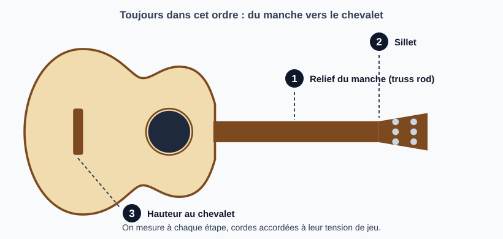
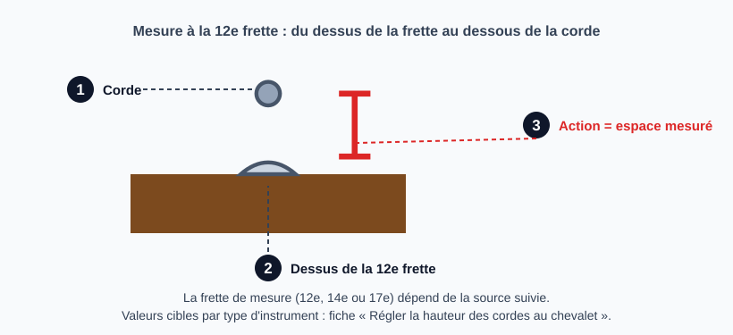

# Ajuster l'action

> L'action est la hauteur des cordes au-dessus des frettes. On la règle dans un ordre précis :
> d'abord la courbure du manche (relief), puis le sillet, puis le chevalet. Toute valeur chiffrée
> ci-dessous est un point de départ à confirmer sur l'instrument et au goût du joueur.

## Risques et points de non-retour

- **Truss rod** : ne jamais forcer. Une rotation à la fois, par petits quarts de tour. Une tige
  grippée ou un écrou rond est à traiter avant de continuer (voir [Débloquer un truss rod coincé](debloquer-truss-rod.md)).
- **Sillet** : on ne peut pas remettre de matière. Limer lentement, mesurer souvent, s'arrêter avant
  la hauteur visée.
- **Chevalet / sillets de chevalet** : sur une acoustique à chevalet collé, abaisser le sillet osseux
  est réversible (on le remplace), poncer le chevalet ne l'est pas.

## Outils et matériel

- Clé de truss rod adaptée au modèle
- Règle graduée en mm (ou règle d'action) et jeu de jauges d'épaisseur
- Capo
- Accordeur
- Limes de sillet (jeu calibré) si le sillet est touché
- Tournevis et clés pour le chevalet
- Cordes neuves ou en bon état, accordées à la tension de jeu

## Étapes

### 1. Accorder et poser l'instrument

Mettre les cordes à leur tension normale et accorder. Régler un instrument avec des cordes
détendues ou usées fausse toutes les mesures. Laisser reposer quelques minutes.

### 2. Mesurer le relief du manche

Le relief dit si le truss rod doit être ajusté : on le mesure avant toute autre retouche. Procédure, tableau de
diagnostic et valeurs dans la fiche [Mesurer le relief du manche](mesurer-relief-manche.md).

**Avant de conclure sur le truss rod**, écarter deux autres causes d'action haute ou de bourdonnements : un sillet
mal taillé (étape 4) et une frette haute ou un manche tordu. Un relief correct avec une action toujours trop haute
ou une corde qui bourdonne ne se règle pas au truss rod.

### 3. Corriger le relief au truss rod

- Serrer (sens horaire) : diminue le relief.
- Desserrer (sens antihoraire) : augmente le relief.

Procédure complète, précautions et pièges : fiche [Ajuster le truss rod](reglage-truss-rod.md).

### 4. Vérifier le sillet de tête

L'espace entre la corde et la 1re frette doit être très faible mais non nul (de l'ordre de 0,010 à 0,020 po, soit 0,25 à 0,5 mm selon la corde et l'instrument).
Une corde qui touche la 1re frette ou bourdonne à vide : entaille trop profonde ; espace trop grand : cordes dures en bas du manche.
Valeurs par corde, mesure et limage de l'entaille : fiche [Régler la hauteur des cordes au sillet de tête](regler-sillet-de-tete.md).

### 5. Mesurer l'action

Mesurer l'espace entre le dessus de la frette et le dessous de la corde, corde grave et corde aiguë, à la frette de la source suivie (12e, 14e ou 17e).

Valeurs cibles par type d'instrument et points de mesure : fiche [Régler la hauteur des cordes au chevalet](regler-hauteur-chevalet.md).

### 6. Ajuster la hauteur au chevalet

- Électrique : vis de hauteur des sillets, un côté à la fois, par petits pas.
- Acoustique : poncer le dessous du sillet de chevalet à plat, sur un support plan (environ deux fois la baisse voulue à la 12e frette ; en dégradé seulement si un côté est déjà bon) ;
  l'inclinaison du manche conditionne la marge disponible (voir fiche *Neck reset* quand elle existera).

Détail, schéma et précautions : fiche [Régler la hauteur des cordes au chevalet](regler-hauteur-chevalet.md). Après chaque changement, réaccorder et remesurer.

### 7. Contrôler l'intonation

Une fois l'action stabilisée, vérifier l'intonation (octave à la 12e frette vs corde à vide) et
la corriger si besoin au chevalet.

## Pièges et erreurs courantes

- Régler sans accorder au préalable, ou avec des cordes mortes.
- Tout corriger au chevalet alors que le relief est mauvais : on masque le problème.
- Truss rod serré à fond sans résultat : le défaut vient d'ailleurs (frette haute, déformation,
  manche mal incliné), voir *Neck reset* ou travail de frettes.
- Oublier que l'humidité et la température font bouger le manche : refaire la mesure à un autre moment.

## Vérifications finales

- [ ] Relief dans la fourchette cible
- [ ] Aucune corde ne bourdonne à vide ni sur les premières frettes
- [ ] Action à la 12e frette dans la fourchette cible, grave et aigu
- [ ] Intonation vérifiée
- [ ] Instrument rejoué à plusieurs positions du manche

## Sources et liens

- [StewMac : How to adjust the action on an electric guitar](https://stewmac.com/video-and-ideas/online-resources/learn-about-string-action-and-setup/how-to-adjust-action-on-an-electric-guitar) : ordre des réglages et vérification des bourdonnements plutôt qu'un chiffre fixe.
- [StewMac : How to measure neck relief on a guitar](https://stewmac.com/video-and-ideas/online-resources/neck-building-and-repair-and-setup/neck-relief-gauge-instructions) : mesure du relief au comparateur.
- [Premier Guitar : Guitar neck relief](https://www.premierguitar.com/diy/guitar-shop-101/guitar-neck-relief) : mesure du relief à la jauge d'épaisseur et valeurs selon le style de jeu.
- [Martin Guitar : SC13E setup adjustment (PDF)](https://www.martinguitar.com/on/demandware.static/-/Library-Sites-MartinSharedLibrary/default/pdf/sc13e-setup-adjustment.pdf) : spécifications de réglage d'un constructeur d'acoustiques (relief mesuré à la 5e frette).

> Les sources ne donnent pas les mêmes valeurs ni les mêmes points de mesure. Se fier d'abord aux spécifications du constructeur de l'instrument.
> Aucune vidéo n'est encore référencée : à ajouter quand une référence est choisie.

## Historique des révisions

| Date | Changement |
|------|------------|
| 2026-10-15 | Création du brouillon : trame générale et valeurs indicatives, à confirmer |
| 2026-10-15 | Truss rod déplacé dans sa propre fiche ; l'étape 3 ne garde que le sens de rotation et un lien |
| 2026-10-15 | Étape 2 : méthode de mesure détaillée et tableau de diagnostic pour décider d'ajuster ou non le truss rod |
| 2026-10-15 | Ajout des sources (sites de luthiers et constructeurs) |
| 2026-10-30 | Mesure du relief déplacée dans la fiche « Mesurer le relief du manche » ; schémas de l'ordre des réglages, du sillet et de l'action à la 12e frette |
| 2026-10-30 | Sillet de tête et hauteur au chevalet déplacés dans deux fiches avec valeurs cibles sourcées ; anciennes valeurs d'action non sourcées retirées |
