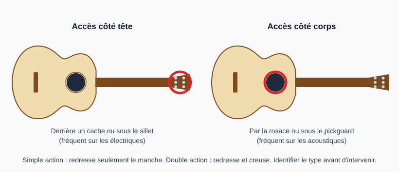
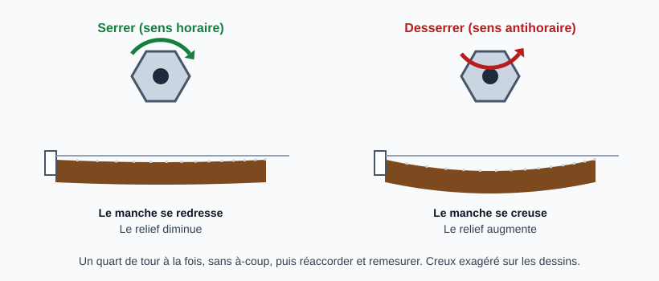

# Ajuster le truss rod

> Le truss rod est la tige métallique logée dans le manche qui contrôle sa courbure longitudinale
> (le relief). Il se règle par petits pas, en mesurant entre chaque, et il ne doit jamais être forcé.
> Les valeurs chiffrées sont des points de départ à confirmer.

## Risques et points de non-retour

- **Forcer** peut arracher le filetage, fendre le manche ou casser la tige : irréparable ou coûteux.
  Une résistance anormale impose de s'arrêter (voir [Débloquer un truss rod coincé](debloquer-truss-rod.md)).
- **Écrou arrondi** (clé qui glisse) : utiliser la clé exacte du modèle, bien enfoncée et droite.
- **Un manche qui ne répond pas** au truss rod n'a pas forcément un problème de truss rod : voir
  *Pièges*.
- **Sens de rotation inversé** sur certains modèles ou réglages particuliers : confirmer avec un
  petit quart de tour et la mesure suivante avant de poursuivre.

## Repérer le type et l'accès

- **Accès côté tête** (derrière le cache ou sous le sillet) : cas fréquent sur électriques.
- **Accès côté corps** (par la rosace, ou sous le pickguard) : cas fréquent sur acoustiques.
- **Simple action** : agit seulement pour redresser le manche.
- **Double action** : agit dans les deux sens (redresser et creuser).

Identifier le type avant d'intervenir (documentation du modèle, constructeur).

## Outils et matériel

- Clé du bon format (pas d'outil de fortune)
- Règle et jauges d'épaisseur, capo
- Accordeur

## Étapes

### 1. Mesurer le relief avant d'agir

Voir la fiche [Mesurer le relief du manche](mesurer-relief-manche.md). Noter la valeur de départ : sans elle,
on ne sait pas dans quel sens ni de combien corriger.

### 2. Détendre légèrement les cordes si l'écrou résiste

Une tige sous tension forte tourne plus difficilement. Détendre un peu les cordes (sans les retirer)
réduit l'effort et protège le filetage. Si l'écrou ne tourne toujours pas, voir [Débloquer un truss rod coincé](debloquer-truss-rod.md).

### 3. Tourner d'un quart de tour au maximum

- **Serrer (sens horaire)** : redresse le manche, diminue le relief.
- **Desserrer (sens antihoraire)** : augmente le relief.

Un quart de tour à la fois, sans à-coup. Si ça résiste, s'arrêter.

### 4. Réaccorder et laisser le manche se stabiliser

Réaccorder, attendre quelques minutes (davantage pour un gros changement), puis remesurer le relief.
Répéter les étapes 3 et 4 jusqu'à la valeur visée.

### 5. Vérifier le résultat sur l'instrument

Contrôler les bourdonnements sur les premières frettes, la hauteur des cordes et le jeu. Poursuivre
avec le sillet et le chevalet (voir [Ajuster l'action](reglage-action.md)).

## Pièges et erreurs courantes

- Tourner de plusieurs tours d'un coup.
- Serrer à fond pour « corriger » une action haute : le défaut est peut-être au sillet, aux frettes
  ou à l'inclinaison du manche.
- Corriger un manche tordu (torsion, pas courbure) avec le truss rod : il ne le corrigera pas.
- Régler à chaud ou par humidité extrême : refaire la mesure à un autre moment.

## Vérifications finales

- [ ] Relief mesuré avant et après
- [ ] Aucune résistance anormale ressentie à la clé
- [ ] Valeur stable après réaccordage et temps de repos
- [ ] Pas de bourdonnement sur les premières frettes

## Sources et liens

- [Premier Guitar : How to adjust guitar neck](https://www.premierguitar.com/diy/guitar-shop-101/how-to-adjust-guitar-neck) : localiser le truss rod et l'ajuster par petits pas.
- [Premier Guitar : Emergency truss rod tweaks](https://www.premierguitar.com/articles/Emergency_Truss_Rod_Tweaks) : cas difficiles, dont les truss rods récalcitrants.
- [StewMac : How to measure neck relief on a guitar](https://stewmac.com/video-and-ideas/online-resources/neck-building-and-repair-and-setup/neck-relief-gauge-instructions) : mesure du relief avant et après réglage.
- [Martin Guitar : SC13E setup adjustment (PDF)](https://www.martinguitar.com/on/demandware.static/-/Library-Sites-MartinSharedLibrary/default/pdf/sc13e-setup-adjustment.pdf) : réglage selon un constructeur d'acoustiques.

> Les schémas exagèrent le creux du manche pour le rendre visible. Aucune vidéo n'est encore référencée.

## Historique des révisions

| Date | Changement |
|------|------------|
| 2026-10-15 | Création du brouillon, extraite de la fiche « Ajuster l'action » |
| 2026-10-15 | Ajout de la section « Débloquer un truss rod coincé » |
| 2026-10-15 | Ajout des sources (sites de luthiers et constructeurs) |
| 2026-10-15 | Déblocage : retrait de l'écrou, graissage du filetage et retour au relief mesuré |
| 2026-10-30 | Déblocage déplacé dans la fiche « Débloquer un truss rod coincé » ; schémas du sens de rotation et de l'accès ; mesure du relief renvoyée à sa fiche |
