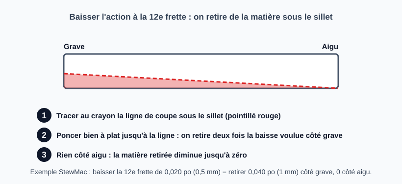

# Régler la hauteur des cordes au chevalet

> Une fois le relief et le sillet de tête réglés, l'action finale se règle au chevalet. Sur une électrique, on joue sur
> les vis de hauteur ; sur une acoustique, on retire de la matière sous le sillet de chevalet (irréversible tant qu'on
> n'a pas de rechange). Les chiffres viennent des sources citées et restent des points de départ, très variables selon le goût.

## Risques et points de non-retour

- **Poncer le sillet d'une acoustique** : on ne remet pas de matière ; pour relever il faut une cale ou un sillet neuf. Préparer un sillet de rechange si l'instrument est précieux.
- **Poncer le chevalet** lui-même (collé) est irréversible : on touche au sillet, pas au chevalet.
- **Sillet de chevalet qui ne repose plus à plat** : la vibration se perd ; poncer bien à plat sur un support plan.
- **Régler la hauteur avant le relief et le sillet de tête** : on masque le problème (voir [Ajuster l'action](reglage-action.md)).

## Valeurs cibles

Hauteur entre le dessus de la frette et le dessous de la corde (valeurs de départ ; chaque source mesure à une frette précise) :

| Source | Instrument | Corde grave | Corde aiguë | Frette |
|--------|------------|-------------|-------------|--------|
| StewMac (page « électrique ») | Électrique | environ 3/32 po (2,4 mm ; la page écrit 2,5) | environ 1/16 po (1,6 mm ; la page écrit 1,5) | **14e** |
| StewMac (page « acoustique ») | Acoustique | 0,090 po (2,3 mm) | 0,070 po (1,8 mm) | 12e |
| Martin SC-13E (manuel) | Acoustique | 0,080 à 0,090 po (2,0 à 2,3 mm), max 0,090 | 0,055 à 0,065 po (1,4 à 1,65 mm), max 0,065 | 12e |
| Owning a Fender (site tiers) | Fender standard | 4/64 po (1,6 mm) | 4/64 po (1,6 mm) | 17e |
| Owning a Fender (site tiers) | Gibson | 5/64 po (2,0 mm) | 4/64 po (1,5 mm) | 12e |
| Owning a Fender (site tiers) | Acoustique « standard » | 7/64 po (2,8 mm) | 5/64 po (2,0 mm) | 12e |

StewMac précise que l'action est une préférence personnelle : « il n'y a pas de règle fixe », et que ses chiffres sont un point de départ (valeurs de l'auteur pour sa propre guitare sur la page acoustique). Les cordes intermédiaires suivent le rayon de la touche. Les chiffres du manuel Martin portent sur un modèle précis (SC-13E) : se fier d'abord aux spécifications du constructeur de l'instrument.

## Outils et matériel

- Règle d'action ou jauge d'épaisseur, jauge de rayon
- Papier de verre fin et support parfaitement plan (acoustique), crayon
- Électrique : clé Allen adaptée (1,5 mm sur une Telecaster), tournevis
- Accordeur
- Sillet de chevalet de rechange pour une acoustique de valeur

## Étapes

### 1. Vérifier ce qui précède

Relief réglé (voir [Mesurer le relief du manche](mesurer-relief-manche.md)) et sillet de tête réglé (voir [Régler la hauteur des cordes au sillet de tête](regler-sillet-de-tete.md)). Cordes accordées à leur tension de jeu.

### 2. Mesurer l'action

Mesurer l'espace entre le dessus de la frette et le dessous de la corde, **à la frette de la source suivie** (12e, 14e ou 17e selon le tableau), corde grave et corde aiguë.

### 3a. Électrique : tourner les vis de hauteur

Régler chaque sillet séparément, par petits pas, un côté à la fois (vis de hauteur ; molette ou plots sur un Tune-O-Matic ; sur un système à vibrato, équilibrer la tension avec la griffe arrière puis reprendre l'accord). Le rayon se règle par la hauteur des sillets d'un bout à l'autre du chevalet. Réaccorder, remesurer.

### 3b. Acoustique : retirer de la matière sous le sillet

Comparer le rayon du sillet à celui de la touche (9,5 po et 10 po, ou 10 po et 12 po, sont assez proches ; 10 po contre 20 po demande de reprofiler le sillet avec une cale de rayon).

**Cas courant : l'action est trop haute partout, on ponce le dessous du sillet à plat.** Le sillet reste un rectangle : on retire la même épaisseur sur toute sa longueur, en frottant le dessous sur du papier de verre fixé sur un support parfaitement plan, jusqu'à la hauteur visée. La corde pivote sur le sillet de tête, donc la baisse à la 12e frette vaut environ la moitié de celle prise sous le sillet : **pour baisser la 12e de 0,020 po, retirer environ 0,040 po** (exemple StewMac, 0,5 mm à la 12e pour 1 mm sous le sillet).

**Cas particulier : un seul côté est trop haut.** Si seules les cordes graves sont trop hautes (cibles différentes grave/aigu), on ponce en dégradé : plus de matière côté grave, dégressivement jusqu'à zéro côté aigu (exemple de la page StewMac : 0,040 po côté grave, zéro côté aigu). Tracer la ligne de coupe au crayon et poncer jusqu'à elle.

Dans les deux cas : vérifier que le dessous reste **plan** (il doit reposer sur toute sa longueur au fond de la fente), remettre en place, réaccorder, remesurer.

### 4. Réaccorder, remesurer, corriger l'intonation

Après chaque changement, réaccorder et remesurer. Une fois l'action stable, contrôler l'intonation (octave à la 12e frette contre corde à vide) ; sur une électrique, si la note frettée est trop haute, reculer le sillet ; si elle est trop basse, l'avancer (StewMac).

## Pièges et erreurs courantes

- Poncer en biais : le sillet ne repose plus à plat.
- Poncer en dégradé alors que l'action est trop haute partout (le côté aigu devient trop bas), ou à plat alors qu'un seul côté est trop haut.
- Comparer ses mesures à un tableau pris à une autre frette que celle utilisée.
- Régler l'action avant d'avoir corrigé le relief ou le sillet de tête.

## Vérifications finales

- [ ] Action dans la valeur cible, grave et aigu, à la frette de la source suivie
- [ ] Aucune corde ne bourdonne sur les frettes
- [ ] Sillet de chevalet bien à plat dans son logement (acoustique)
- [ ] Intonation vérifiée à la 12e frette

## Sources et liens

- [StewMac : How to adjust the action on an electric guitar](https://stewmac.com/video-and-ideas/online-resources/learn-about-string-action-and-setup/how-to-adjust-action-on-an-electric-guitar) : action mesurée à la 14e frette (environ 3/32 po grave, 1/16 po aigu), réglage sillet par sillet, intonation.
- [StewMac : How to adjust the action on an acoustic guitar](https://www.stewmac.com/video-and-ideas/online-resources/learn-about-string-action-and-setup/how-to-adjust-the-action-on-an-acoustic-guitar-/) : action à la 12e frette (0,090 po grave, 0,070 po aigu pour l'exemple), retrait de matière sous le sillet.
- [Martin Guitar : SC-13E set-up and adjustment (PDF)](https://www.martinguitar.com/on/demandware.static/-/Library-Sites-MartinSharedLibrary/default/pdf/sc13e-setup-adjustment.pdf) : action recommandée à la 12e frette d'une acoustique de série (basses 0,080 à 0,090 po, aigus 0,055 à 0,065 po).
- [Owning a Fender : Setup specs lookup](https://owningafender.com/setup-specs-lookup) : action standard Fender, Gibson et acoustique ; site tiers non affilié.

> Les valeurs Martin ont été relevées dans un extrait du manuel SC-13E ; le PDF n'a pas pu être relu par notre outil de lecture, à vérifier dans le document. Les chiffres du site tiers (Fender, Gibson, acoustique standard) ne sont pas vérifiés chez les constructeurs. La conversion des fractions en mm est la nôtre ; la page StewMac écrit 2,5 mm et 1,5 mm. Aucune valeur de protrusion du sillet n'a été trouvée.

## Historique des révisions

| Date | Changement |
|------|------------|
| 2026-10-30 | Création du brouillon, extraite des étapes 5 et 6 de la fiche « Ajuster l'action » ; valeurs cibles sourcées ; schéma du ponçage du sillet |
