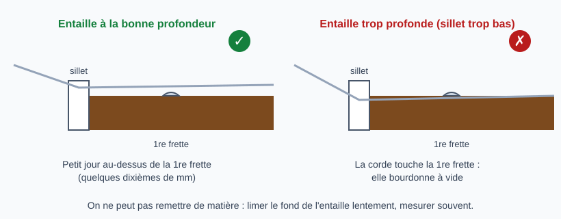

# Régler la hauteur des cordes au sillet de tête

> Au sillet de tête, ce qui compte est l'espace entre la corde et la 1re frette : très faible mais jamais nul.
> On ne peut que retirer de la matière : limer le fond de l'entaille lentement, mesurer souvent, et s'arrêter avant
> la valeur visée. Les chiffres viennent des sources citées et restent des points de départ.

## Risques et points de non-retour

- **Entaille trop profonde** : la corde touche la 1re frette et bourdonne à vide. On ne remet pas de matière (remplacer le sillet ou le rattraper, travail de luthier).
- **Entaille trop haute** : cordes dures dans les premières positions, notes justes en haut du manche mais fausses en bas.
- **Mauvaise lime** : une lime trop large élargit l'entaille et fait vibrer la corde ; une corde enfoncée de plus de la moitié ou des trois quarts de son diamètre est trop profonde (StewMac).
- **Régler le sillet avant le relief** : un relief faux fausse toute la mesure (voir [Mesurer le relief du manche](mesurer-relief-manche.md)).

## Valeurs cibles

Espace entre la corde et le dessus de la 1re frette (valeurs de départ, à confirmer sur l'instrument) :

| Cordes | Espace visé | Source |
|--------|-------------|--------|
| Électrique, Mi grave | environ 0,020 po (0,5 mm) | StewMac, « Nut making and setup » |
| Électrique, Mi aigu | environ 0,010 po (0,25 mm) | StewMac, « Nut making and setup » |
| Électrique, cordes intermédiaires | hauteurs graduées selon le rayon de la touche | StewMac |
| Acoustique, Mi grave et La | environ 0,020 po (0,5 mm) | StewMac, réglage d'action d'une acoustique (préférence de l'auteur) |
| Acoustique, Ré et Sol | environ 0,015 po (0,38 mm) | idem |
| Fender (électrique) | 0,020 à 0,022 po (0,5 à 0,56 mm) | site tiers, non vérifié chez Fender |

Les cordes d'électrique peuvent en général être plus proches de la 1re frette que celles d'acoustique (StewMac). Les valeurs pour Si et Mi aigu d'une acoustique ne sont pas données par ces sources.

**Sillet neuf** : le fond des entailles se place à la hauteur de la frette plus environ 0,030 po (0,76 mm) avant le réglage fin (par exemple frette de 0,040 po, profondeur d'entaille 0,070 po, soit 1,8 mm) (StewMac).

## Outils et matériel

- Jeu de limes de sillet calibrées (un calibre par corde) ou lime fine du bon diamètre
- Jauge d'épaisseur ou jauge de rainurage (StewMac) pour mesurer au niveau de la 1re frette
- Capo, accordeur
- Cordes en bon état, accordées à leur tension de jeu

## Étapes

### 1. Régler d'abord le relief

Le manche doit être correct avant de toucher au sillet (voir [Mesurer le relief du manche](mesurer-relief-manche.md)). Accorder.

### 2. Mesurer l'espace au-dessus de la 1re frette

Appuyer la corde à la 3e frette et mesurer le petit jour au-dessus de la 1re frette, corde par corde, avec une jauge d'épaisseur (technique courante de lutherie ; la jauge de rainurage StewMac mesure directement à la 1re frette, c'est la mesure la plus précise selon StewMac).

### 3. Comparer aux valeurs cibles

- **Corde qui touche la 1re frette ou bourdonne à vide** : entaille trop profonde ou mal profilée.
- **Espace trop grand** : entaille à approfondir.

### 4. Limer le fond de l'entaille

Limer seulement le fond de l'entaille, avec la lime du bon calibre, en suivant l'angle vers la tête. Passer corde par corde, par petites passes, puis remesurer. Ne jamais limer le côté de l'entaille.

### 5. Remesurer et vérifier à vide

Réaccorder, remesurer chaque corde, puis jouer à vide et sur les premières frettes : aucun bourdonnement, notes justes en bas du manche.

## Pièges et erreurs courantes

- Tout limer d'un coup sans remesurer entre deux passes.
- Mesurer cordes détendues.
- Limer l'entaille pour compenser un relief mal réglé.
- Utiliser une lime trop grosse pour la corde.

## Vérifications finales

- [ ] Espace au-dessus de la 1re frette dans la valeur cible, corde par corde
- [ ] Aucune corde ne touche la 1re frette ni ne bourdonne à vide
- [ ] Aucune corde enfoncée de plus de la moitié ou des trois quarts de son diamètre
- [ ] Notes justes dans les premières positions

## Sources et liens

- [StewMac : Nut making and setup](https://www.stewmac.com/video-and-ideas/online-resources/learn-about-guitar-nut-and-saddle-setup-and-repair/nut-making-and-setup/) : fond d'entaille à la hauteur de la frette plus 0,030 po, dégagement visé de 0,020 po (Mi grave) et 0,010 po (Mi aigu) pour une électrique.
- [StewMac : Nut slotting gauge instructions](https://www.stewmac.com/video-and-ideas/online-resources/learn-about-guitar-nut-and-saddle-setup-and-repair/nut-slotting-gauge-instructions/) : mesure au niveau de la 1re frette, la plus précise ; les cordes d'électrique peuvent être plus proches de la 1re frette que celles d'acoustique.
- [StewMac : How to adjust the action on an acoustic guitar](https://www.stewmac.com/video-and-ideas/online-resources/learn-about-string-action-and-setup/how-to-adjust-the-action-on-an-acoustic-guitar-/) : valeurs d'une acoustique (0,020 po pour Mi et La, 0,015 po pour Ré et Sol) et profondeur maximale d'enfoncement de la corde.
- [Owning a Fender : Setup specs lookup](https://owningafender.com/setup-specs-lookup) : dégagement de 0,020 à 0,022 po au-dessus de la 1re frette attribué à Fender ; site tiers non affilié, non vérifié chez le constructeur.

> Les valeurs StewMac sont des choix de l'auteur (« préférence ») et non des spécifications de constructeur. Aucune valeur Martin ou Taylor n'a pu être lue. La mesure à la 3e frette vient de la pratique courante, non d'une des sources lues.

## Historique des révisions

| Date | Changement |
|------|------------|
| 2026-10-30 | Création du brouillon, extraite de l'étape 4 de la fiche « Ajuster l'action » ; valeurs cibles sourcées ; schéma du sillet |
