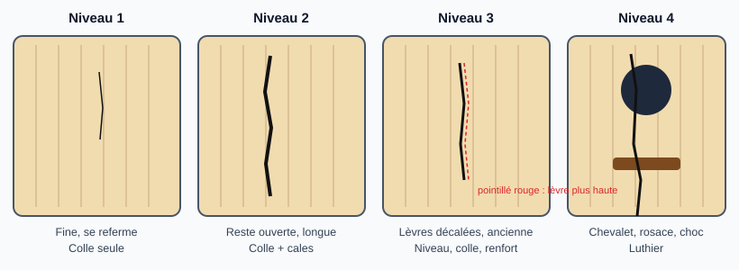
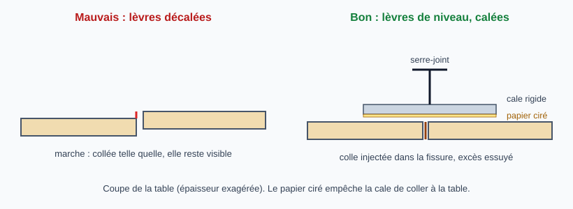
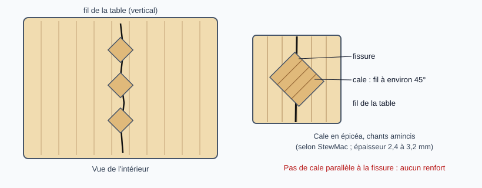

# Réparer une fissure dans la table d'harmonie

> La réparation dépend de l'état de la fissure : elle va d'un simple recollage après retour à une humidité relative normale
> (niveau 1) à un travail de luthier (niveau 4). Il faut donc **classer la fissure avant d'agir**, puis
> chercher la cause. Les cales de renfort (« cleats ») ne sont pas automatiques : certains luthiers
> les jugent inutiles, voire nuisibles, sur une fissure qui se referme bien.
>
> La difficulté de l'en-tête (3/5) est une valeur moyenne : l'échelle réelle est dans le tableau ci-dessous.

## Diagnostic : quel niveau de réparation ?

Observer la fissure **avec l'instrument à son humidité normale** (voir étape 1). Une fissure ouverte
par la sécheresse peut changer de catégorie une fois l'instrument revenu à une humidité normale.

| Niveau | État de la fissure | Conduite | Difficulté |
|:------:|--------------------|----------|:----------:|
| 1 | Fissure fine, récente, qui se referme en humidité normale, lèvres de niveau | Laisser l'instrument retrouver une humidité normale, puis recollage simple. Pas de cales | 2/5 |
| 2 | Fissure qui reste ouverte, longue, ou qui se rouvre à chaque saison, lèvres de niveau | Recollage **et** cales à l'intérieur | 3/5 |
| 3 | Lèvres décalées (une plus haute que l'autre), fissure ancienne et encrassée, table enfoncée, barrage ou entretoise décollé près de la fissure | Remettre de niveau, nettoyer, recoller, souvent réparer le barrage, cales ou renfort | 4/5 |
| 4 | Choc avec fibres écrasées ou lambeau replié, fissure qui traverse le chevalet, la rosace ou un barrage, table très mince (« double top »), instrument de valeur ou vernis d'origine à préserver | **Confier à un luthier** | 5/5 |

La fiche détaille les niveaux 1 à 3 ; le niveau 4 n'est décrit que pour le reconnaître.

**Fissure du bois ou fissure du vernis ?** Une fissure discrète peut n'être que dans le vernis, sans réparation de structure. Indices cités par des luthiers sur des forums (à confirmer avec l'atelier) : une fissure du bois suit le fil, souvent près du chevalet, et traverse l'épaisseur de la table ; une fissure qui coupe le fil à angle droit est probablement dans le vernis seul ; regarder sous lumière rasante, avec les cordes détendues : des fibres encore en contact indiquent une fissure serrée, une gorge visible une fissure séparée. Le doute justifie de retirer la tension des cordes et de faire examiner l'instrument.

**Exemples réels** (photos de Frank Ford, [Frets.com](https://www.frets.com/pages/xgadge6a/Crack-Repair), affichées depuis le site d'origine et non copiées) :

*Niveau 1 à 2 : fissure fine, discrète, qui part de derrière le chevalet et suit le fil de la table (Taylor). C'est le cas le plus courant, et on ne la voit qu'en regardant de près. Source : [Hebikuo, cas de réparation Taylor et Martin](https://fr.hebikuo.com/blog/how-to-repair-cracks-on-guitar) (blog d'un vendeur d'accessoires, photo hébergée chez eux).*

*Niveau 1 : fissure fine près du chevalet, que seule la lumière rasante révèle. Source : [Frets.com, Body Cracks](https://www.frets.com/pages/5sin4n18/Body-Cracks).*

*Niveau 1 à 2 : trois fissures fines et longues, orientées le long du fil (flèches de l'auteur), sur une Martin de 1887. Source : [Frets.com, Looking at Cracks](https://www.frets.com/pages/59oqhbml/Looking-at-Cracks).*

*Niveau 2 à 3 : fissure qui s'ouvre en éclats près de la touche (Martin 0-16). Source : [Frets.com, Looking at Cracks](https://www.frets.com/pages/59oqhbml/Looking-at-Cracks).*

*Niveau 3 : fissure dans la table d'épicéa avec un plissement au bord, vue de côté. Source : [Frets.com, Looking at Cracks](https://www.frets.com/pages/59oqhbml/Looking-at-Cracks).*

*Niveau 3 : fissure ancienne, encrassée, près de la rosace d'une Gibson LG-2. Source : [Frets.com, A simple top crack repair](https://www.frets.com/pages/xmlg02db/A-Simple-Top-Crack-Repair).*

*Niveau 3 à 4 : après une chute, le bord de la table déborde de la bordure (Taylor 12 cordes). Source : [Frets.com, Taylor 12-string](https://www.frets.com/pages/xgadge6a/Crack-Repair).*

*Niveau 4 : table très mince (« double top ») enfoncée près du talon, à confier à un luthier. Source : [Frets.com, Vacuum leveling](https://www.frets.com/pages/pzbarj9w/Vacuum-Leveling-for-Crack-Repair).*

Chercher aussi la **cause** : instrument conservé trop au sec, barrage décollé, choc. Une fissure
n'est pas toujours la cause d'un bourdonnement : elle peut accompagner un barrage desserré, à
contrôler après réparation (voir *Vérifications finales*). Réparer sans corriger la cause prépare la
fissure suivante.

## Risques et points de non-retour

- **Colle posée sur un bois encore trop sec** : la fissure collée « de force » se rouvre, parfois à
  côté de la réparation. Laisser d'abord l'instrument retrouver une humidité normale.
- **Fissure restée ouverte longtemps** : elle peut garder une « mémoire » et ne plus se refermer
  correctement (Galloup) ; il faut alors la traiter comme un niveau 2 ou 3.
- **Cales superflues ou mal posées** : elles ajoutent de la masse sur la table, nuisent au son et sont
  difficiles à retirer. Si l'instrument se dessèche de nouveau, la table peut fendre à côté de la cale.
- **Lèvres collées décalées** : la réparation reste visible et ne se rattrape pas ; mettre de niveau avant de coller.
- **Colle irréversible** : une colle de peau peut se reprendre à chaud ; ce n'est pas le cas de la
  cyanoacrylate ou d'une colle polyuréthane. Sur une réparation qu'on voudra peut-être reprendre, éviter ces dernières.
  *(Le halo jaune de la cyanoacrylate sur l'épicéa vient de l'ancienne version de la fiche, non confirmé par les sources.)*
- **Excès de colle** à l'extérieur ou à l'intérieur : essuyer aussitôt.

## Outils et matériel

Commun aux niveaux 1 à 3 :

- Humidificateur d'instrument, hygromètre
- Colle : colle de peau (la **Titebond Liquid Hide Glue** est celle de la démonstration StewMac) ou
  colle à bois jaune pour une fissure ancienne et encrassée ; seringue ou fine lame pour la faire pénétrer
- Ruban de masquage ou ruban de protection à faible adhérence, chiffon, eau chaude pour les bavures
- Miroir et lampe pour travailler à l'intérieur de la caisse

Niveau 1 : cale plate (caul) en acrylique ou en bois, **papier ciré** pour qu'elle ne colle pas, serre-joint.

Niveaux 2 et 3, en plus :

- Cales (« cleats ») dans la même essence que la table (épicéa le plus souvent) ; épaisseur de l'ordre de 3/32 à
  1/8 po (2,4 à 3,2 mm) selon StewMac ; Galloup parle d'une taille d'environ « une pièce de dix cents »
- Cale de répartition (caul) en acrylique ou en bois recouvert de plastique ou de papier ciré
- Outil pour tirer la cale en place : kit de réparation de fissures StewMac (fil, ancrage, serre-fissure), ou
  système à aimants (Thompson) ; à défaut, plusieurs serre-joints et cales
- Niveau 3 : sonde ou crochet pour soulever les lèvres, serre-joints à long bras, plaque acrylique

## Étapes

Les étapes sont dans l'ordre où on les fait. Chacune indique les niveaux concernés : **niveau 1** = étapes 1, 2, 5 et 8 ; **niveau 2** = en plus les étapes 6 et 7 ; **niveau 3** = toutes les étapes.

### 1. Laisser l'instrument retrouver une humidité relative normale (niveaux 1 à 3)

**On ne mouille pas la guitare** : on corrige l'air autour d'elle (cible 45 à 55 % d'humidité relative). Procédure, méthode du sac et précautions dans la fiche
[Laisser une guitare retrouver une humidité normale](retrouver-humidite-normale.md). Si la fissure se referme, rester au niveau 1 ; si elle reste ouverte
(c'est arrivé dans la démonstration de StewMac), passer au niveau 2.

> **Vidéo** : [StewMac : How to fix a guitar crack caused by humidity damage](https://www.stewmac.com/video-and-ideas/trade-secrets/how-to-fix-a-guitar-crack-caused-by-humidity-damage/) (Dan Erlewine, avec transcription) : la méthode du sac, le collage par l'extérieur et la cale à l'intérieur.

### 2. Nettoyer et protéger (niveaux 1 à 3)

Souffler la poussière, dégraisser l'intérieur de la fissure et masquer le vernis autour : procédure complète, produits et précautions dans la fiche
[Nettoyer et dégraisser une fissure avant collage](nettoyer-avant-collage.md). Sur une fissure ancienne et encrassée (niveau 3), ouvrir doucement la fissure avec un crochet
appuyé sur un barrage pour nettoyer la saleté ancienne.

### 3. Recoller ce qui est décollé sous la table (niveau 3)

Barrage ou entretoise décollé près de la fissure : le recoller à la spatule, sous la table, **avant** de coller la fissure ; c'est lui qui soutient la table pendant la mise de niveau et le serrage.

> **Photos** : [Frets.com : A simple top crack repair](https://www.frets.com/pages/xmlg02db/A-Simple-Top-Crack-Repair) (fissure ancienne et encrassée, entretoise décollée).

### 4. Remettre les lèvres de niveau (niveau 3)

Si une lèvre est plus haute que l'autre, la repousser depuis l'intérieur (un barrage sert d'appui) et la maintenir **de niveau** avec une cale extérieure et des serre-joints, **avant** de coller. Essayer à blanc, sans colle, pour vérifier que le serrage ne recrée pas de décalage.

> **Photos** : [Frets.com : A simple top crack repair](https://www.frets.com/pages/xmlg02db/A-Simple-Top-Crack-Repair) ; [Frets.com : Taylor 12-string, top and side cracks](https://www.frets.com/pages/xgadge6a/Crack-Repair) (ouverture de la fissure, serrage).

### 5. Coller la fissure (niveaux 1 à 3)

Entrouvrir légèrement la fissure (par exemple en poussant la table depuis la rosace), faire pénétrer peu de colle sur toute la longueur, essuyer l'excès aussitôt. Serrer légèrement avec une cale plate sur la table,
papier ciré intercalé, pour garder les lèvres de niveau. Ne pas toucher pendant 24 heures. Colle : Titebond Liquid Hide Glue dans la démonstration StewMac ; Frets.com utilise une colle de peau **claire** sur de l'épicéa blond pour éviter de tacher, et une colle à bois jaune sur une fissure ancienne et sale.

> **Vidéo** : [StewMac : How to fix a guitar crack caused by humidity damage](https://www.stewmac.com/video-and-ideas/trade-secrets/how-to-fix-a-guitar-crack-caused-by-humidity-damage/) (même vidéo, partie collage). **Photos** : [Frets.com : Taylor 12-string, top and side cracks](https://www.frets.com/pages/xgadge6a/Crack-Repair) (colle dans la fissure, serrage).

### 6. Préparer les cales (niveaux 2 et 3)

Découper des cales en bois assorti à la table, **fil croisé** par rapport à la fissure (StewMac : environ 45°
avec la fissure, à vérifier au miroir), chants amincis. Elles « cousent » la fissure : peu, petites, espacées de quelques centimètres.

> **Photos** : [StewMac : Crack repair tool instructions](https://www.stewmac.com/video-and-ideas/online-resources/learn-about-repair-tools-and-repair-techniques/stewmac-crack-repair-tool-instructions) (découpe des cales, cale de répartition). **Avis** : [Premier Guitar : to cleat or not to cleat](https://www.premierguitar.com/acoustic-soundboard-to-cleat-or-not-to-cleat) (une photo de cales en palissandre sur une Martin vintage ; quand s'en passer).

### 7. Poser les cales ou le renfort à l'intérieur (niveaux 2 et 3)

Après le collage extérieur, coller chaque cale en pont sur la fissure, à l'intérieur de la caisse, en la plaquant contre la table
(fil et ancrage dans le kit StewMac, aimants avec le système Thompson). Faire un essai à blanc sans colle pour mesurer la tension
nécessaire. Avec un kit, la colle peut aussi être injectée par l'extérieur à faible pression (StewMac cite 10 psi). Essuyer les
bavures à l'eau chaude, contrôler à la lampe. Selon la zone, une pièce plate d'épicéa d'environ 3/32 po à fil croisé, collée à la place des cales,
renforce le niveau 3 (exemples Frets.com). Ne pas multiplier les renforts.

> **Vidéos** : [StewMac : Crack repair tools](https://www.stewmac.com/video-and-ideas/tool-demo-videos/luthier-tools-and-supplies-videos/stewmac-crack-repair-tools-video/) (kit à fil et ancrage, non revue en détail) ; [StewMac : TJ Thompson top crack repair](https://www.stewmac.com/video-and-ideas/tool-demo-videos/luthier-tools-and-supplies-videos/tj-thompson-top-crack-repair-video) (cale par aimants, fissure jusqu'au chevalet sur une Martin 1941).
> **Photos** : [StewMac : Crack repair tool instructions](https://www.stewmac.com/video-and-ideas/online-resources/learn-about-repair-tools-and-repair-techniques/stewmac-crack-repair-tool-instructions) (essai à blanc, injection de colle, serrage) ; [Frets.com : A simple top crack repair](https://www.frets.com/pages/xmlg02db/A-Simple-Top-Crack-Repair) et [Frets.com : Taylor 12-string, top and side cracks](https://www.frets.com/pages/xgadge6a/Crack-Repair) (renforts d'épicéa à l'intérieur).

### 8. Finition (niveaux 1 à 3)

Reboucher le petit trou laissé par le fil ou la fissure, teinter la ligne de colle si besoin et retoucher avec des produits compatibles
avec le vernis d'origine. Sur une finition nitro, voir un luthier si la retouche doit être invisible.

## Quand confier l'instrument à un luthier (niveau 4)

- Fibres écrasées ou lambeau replié par un choc
- Fissure qui traverse le chevalet, la rosace ou un barrage
- Table très mince ou « double top » : Frets.com la répare sous vide avec de la colle de peau diluée, photos dans [Frets.com : Vacuum leveling for crack repair](https://www.frets.com/pages/pzbarj9w/Vacuum-Leveling-for-Crack-Repair) (pour information)
- Lèvres qui refusent de se mettre de niveau malgré l'humidité
- Instrument de valeur, ancien, ou vernis d'origine à préserver

## Pièges et erreurs courantes

- Coller une fissure encore ouverte parce que le bois est sec, sans avoir laissé d'abord l'instrument retrouver une humidité normale.
- Poser des cales systématiquement, y compris sur une fissure qui se recolle seule et reste stable.
- Utiliser une colle impossible à défaire pour une réparation qu'on voudra peut-être reprendre.
- Oublier de remettre les lèvres de niveau avant de serrer.
- Ne pas corriger la cause (instrument qui continue à sécher) : la fissure reviendra, parfois ailleurs.

## Vérifications finales

- [ ] Fissure fermée et de niveau, au toucher et à la lumière rasante
- [ ] Aucun bourdonnement ni vibration parasite en jouant (cales bien collées)
- [ ] Barrages proches de la fissure toujours collés (tapoter, écouter)
- [ ] Humidificateur en place et hygromètre dans l'étui
- [ ] Instrument resurveillé après quelques semaines (la fissure ne se rouvre pas)

## Sources et liens

- [Premier Guitar : Acoustic soundboard, to cleat or not to cleat (Bryan Galloup)](https://www.premierguitar.com/acoustic-soundboard-to-cleat-or-not-to-cleat) : une fissure d'humidité qui se referme bien tient par la colle seule ; les cales ajoutent de la masse et peuvent provoquer une fissure à côté ; elles se justifient quand un simple collage ne tiendra pas.
- [Frets.com : Crack repair (Frank Ford)](https://www.frets.com/pages/xgadge6a/Crack-Repair) : réparation d'une table et d'une éclisse après une chute, colle de peau claire, renforts d'épicéa.
- [Frets.com : A simple top crack repair (Frank Ford)](https://www.frets.com/pages/xmlg02db/A-Simple-Top-Crack-Repair) : fissure ancienne et encrassée, colle à bois jaune, renfort d'épicéa d'environ 3/32 po.
- [StewMac : Crack repair tool instructions](https://www.stewmac.com/video-and-ideas/online-resources/learn-about-repair-tools-and-repair-techniques/stewmac-crack-repair-tool-instructions) : cales en bois assorti de 3/32 à 1/8 po, fil à environ 45° de la fissure.
- [StewMac : How to fix a guitar crack caused by humidity damage](https://www.stewmac.com/video-and-ideas/trade-secrets/how-to-fix-a-guitar-crack-caused-by-humidity-damage/) : retour à l'humidité normale (méthode du sac), Titebond Liquid Hide Glue, cale interne.
- [StewMac : TJ Thompson top crack repair](https://www.stewmac.com/video-and-ideas/tool-demo-videos/luthier-tools-and-supplies-videos/tj-thompson-top-crack-repair-video) : cale à aimants (cartouche usinée) pour les fissures près du chevalet.

> Photos et vidéos : liens placés dans les étapes concernées ; aucune image n'est copiée dans le dépôt (public, droits des auteurs).

> **À confirmer** : les pages ont été lues par un agent de lecture ; pour les pages longues, la fin n'est connue que par
> un résumé automatique. La division en quatre niveaux et leurs critères sont une
> synthèse qui n'apparaît telle quelle dans aucune source. Les sources divergent sur les cales (Galloup : souvent inutiles ;
> StewMac : procédure standard) et sur la colle (peau claire, colle jaune pour les fissures sales). À valider avec la pratique
> de l'atelier avant `validee`. Aucune vidéo en français n'a été trouvée.

## Historique des révisions

| Date | Changement |
|------|------------|
| 2026-10-30 | Création (brouillon) |
| 2026-10-30 | Relecture contre les sources : quatre niveaux de gravité, correction de l'orientation des cales (45°, fil croisé), colles, section photos et vidéos |
| 2026-10-30 | Ajout de trois schémas SVG originaux (niveaux de gravité, mise de niveau des lèvres, orientation des cales) |
| 2026-10-30 | Ajout de photos réelles de Frets.com, affichées depuis le site d'origine (non copiées), avec crédit et lien |
| 2026-10-30 | Ajout d'une photo de fissure discrète et d'un encadré fissure du bois ou du vernis |
| 2026-10-30 | Nettoyage et dégraissage déplacés dans la fiche « Nettoyer et dégraisser une fissure avant collage » (renvoi à l'étape 2) |
| 2026-10-30 | Étapes remises dans l'ordre chronologique (nettoyer, recoller les barrages, mettre de niveau, puis coller, cales, finition) avec les niveaux concernés par étape |
