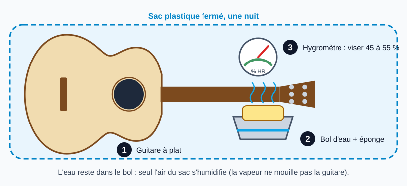

# Laisser une guitare retrouver une humidité normale

> On ne mouille pas la guitare : on corrige l'**air** autour d'elle pour que le bois reprenne son humidité
> d'équilibre. C'est la première étape de la plupart des réparations de fissures de table, et la meilleure
> prévention. La cible usuelle est de 45 à 55 % d'humidité relative.

## Risques et points de non-retour

- **Eau en contact avec la guitare** : jamais d'éponge ou de gouttes posées sur la table, la touche ou la fissure.
- **Excès d'humidité** : un instrument trop humide gonfle (table bombée, action haute). Surveiller l'hygromètre, ne pas dépasser la plage visée.
- **Passer trop vite d'un air très sec à un air très humide** : le bois bouge ; laisser du temps. *(Précaution de bon sens, non tirée d'une source.)*
- **Une fissure ne disparaît pas** : elle peut se refermer en partie, mais le bois ne se ressoude pas ; elle reste à coller (voir la fiche [Réparer une fissure dans la table](reparation-fissure-table.md)).

## Reconnaître un instrument trop sec

D'après Bob Taylor (Premier Guitar) : frettes qui dépassent de la touche, action qui baisse, table qui rétrécit et peut se fendre (jusqu'à environ 1/8 po de retrait).

## Outils et matériel

- Hygromètre (à poser près de la guitare, dans la pièce ou dans l'étui)
- Humidificateur d'instrument (pour la caisse ou l'étui) pour le maintien dans la durée
- Pour la méthode rapide : petit bol d'eau, éponge, grand sac plastique (sac-poubelle) assez grand pour la guitare à plat

## Étapes

### 1. Mesurer

Poser un hygromètre près de l'instrument et lire l'humidité relative. Sous environ 45 %, l'air est trop sec pour une acoustique.

### 2. Laisser la guitare retrouver l'équilibre

**Dans la durée** : humidificateur dans l'étui ou dans la caisse (par la rosace), hygromètre dans l'étui. Compter plusieurs jours, voire plusieurs semaines
pour une table très sèche.

**Méthode rapide** (StewMac, pour une fissure récente) : guitare à plat dans un grand sac plastique avec un petit bol d'eau contenant une éponge et un hygromètre, une nuit.
L'eau reste dans le bol : seule l'air du sac s'humidifie.

### 3. Vérifier

Relire l'hygromètre. Si la fissure s'est refermée, elle se colle (niveau 1). **Dans la démonstration de StewMac elle ne s'est pas refermée** (printemps pluvieux) : il faut alors
passer à une réparation avec cales (niveau 2).

### 4. Garder l'humidité stable

Remettre la guitare dans son étui avec l'humidificateur et l'hygromètre. Les variations de saison (poêle, climatisation, hiver) sont la cause de la plupart de ces fissures.

## Pièges et erreurs courantes

- Mettre une éponge mouillée au contact de la guitare.
- Coller la fissure avant que le bois ait retrouvé son humidité : elle se rouvrira.
- Se fier au « ressenti » plutôt qu'à un hygromètre.
- Oublier l'humidificateur après la réparation.

## Vérifications finales

- [ ] Hygromètre entre 45 et 55 % d'humidité relative
- [ ] Aucune trace d'eau sur la guitare
- [ ] Humidificateur et hygromètre en place dans l'étui
- [ ] Fissure observée de nouveau avant d'être collée

## Sources et liens

- [StewMac : How to fix a guitar crack caused by humidity damage](https://www.stewmac.com/video-and-ideas/trade-secrets/how-to-fix-a-guitar-crack-caused-by-humidity-damage/) : méthode du sac (bol d'eau, éponge, hygromètre, une nuit) ; elle a échoué dans le cas montré.
- [Taylor Guitars : 5 guitar care essentials (Wood & Steel)](https://woodandsteel.taylorguitars.com/guitar-guide/the-2025-guitar-guide/5-guitar-care-essentials/) : hygromètre, plage de 45 à 55 % d'humidité relative, air trop sec qui peut déformer et fendre le bois.
- [Premier Guitar : How humidity affects your guitar (Bob Taylor)](https://www.premierguitar.com/how-humidity-affects-your-guitar) : signes d'une guitare sèche (frettes qui dépassent, action basse, table qui rétrécit).

> Les consignes sur les excès d'humidité et la progression sont du bon sens non sourcé ; la durée (plusieurs jours à semaines) vient de la fiche d'origine et de forums. À confirmer avec l'atelier.

## Historique des révisions

| Date | Changement |
|------|------------|
| 2026-10-30 | Création du brouillon, extraite de l'étape 1 de la fiche sur la fissure de table |
